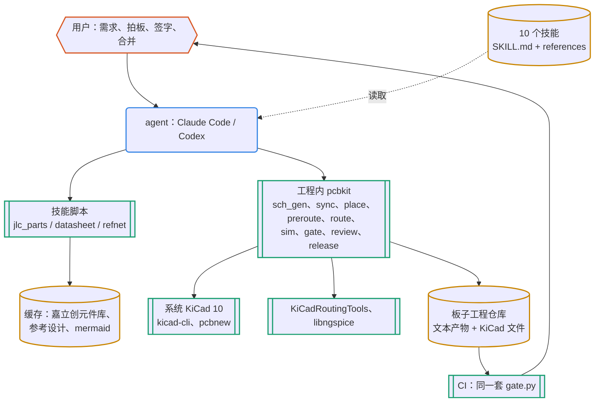

# 开源 PCB 设计流程：技能 + 工具包 + 门禁

资料与实测截至 2026-10-10。依据是一份 AI 与 EDA 工具调研报告（`ANALYSIS.zh-CN.md`，不在本仓库，下称“研究报告”）的第 6 节，以及 S3 AMOLED 复刻工程的实践。本文是总体说明；agent 实际执行的步骤写在 `skills/*/SKILL.md` 和各自的 `references/` 里。

## 1. 结论：可以，但各阶段的成熟度不同

研究报告里两篇 HN 讨论的共识是：模型擅长文本化的环节，几何布局弱，验证必须交给确定性工具。据此，这套流程把“能交给 agent 的部分”和“必须由工具判定的部分”分开：

| 阶段 | agent 可以做到的程度（实测或依据） | 由什么判定对错 |
| --- | --- | --- |
| 需求整理 | 高。把一句话需求整理成编号、可验证的条目，并追问缺口 | 人工签字 |
| 选料 | 高。离线库约 80 万种料，检索、比较和成本核算都有脚本 | 库存和价格快照；数据手册核对 |
| 数据手册整理 | 中到高。能抽文本、看图；示例中查出了“标题 100 mA，保证值只有 70 mA”“同名 PDF 是另一家厂商的”“引脚编号与 KiCad 相反” | 每条带页码；与 KiCad 符号和封装自动比对 |
| 参考设计 | 高，前提是有 KiCad、Altium 等源文件；只有 PDF 时降为中（手工转录） | 逐脚对比 |
| 原理图（代码） | 高。网表是文本，SKiDL 加 sch_gen 可以生成可读的原理图 | ERC、连接意图、引脚对焊盘、生成复现 |
| 仿真 | 中。写 deck 和角点没问题，模型来源是瓶颈 | 断言，阈值带出处 |
| 规则与摆位 | 中。机械约束和关键器件要有人给意图，脚本执行 | DRC、庭院、指标 |
| 布线 | 低到中。小板自动布线可行，但会出现外壳下走线、盘中孔、不遵守自定义规则等问题；关键网络必须显式预布线 | DRC、指标、人工看图 |
| 审查 | 高（研究报告公认收益最高） | 证据和分级；发现转成门禁 |
| EMC、SI、热、射频、机械装配 | 低。只能标“待确认” | 实测、专用工具 |

所以合适的形态是：**技能**告诉 agent 怎么做、为什么；**工具包**把能确定的事做成可复现的脚本；**门禁**说了算。

## 2. 架构



图例：橙色六边形是人，蓝色圆角框是 agent，青绿框是确定性工具，黄色圆柱是文件和数据。各阶段的流程图、一次改动的时序图、证据追溯链和文件数据流见 [docs/SKILLS.zh-CN.md](docs/SKILLS.zh-CN.md)；每个技能的 SKILL.md 里也有自己的流程图。

目录结构：

```
pcb-pipeline/                     （本仓库）
├── skills/                       10 个技能（Agent Skills 格式：SKILL.md + references/ + scripts/）
│   ├── pcb-pipeline/             总控：阶段、事务化改动、新建或接管工程
│   │   ├── kit/                  pcbkit：复制进每个工程，CI 也只依赖它（标准库 + KiCad 的 pcbnew）；
│   │   │                         extras.py 调外部工具做可选输出，vendor/ 放固定版本的 kicanvas.js
│   │   ├── assets/template/      工程模板：pcb.toml、docs/、design/、layout/、checks/、sim/、parts/、CI
│   │   └── scripts/new_project.py
│   ├── pcb-parts/                选料（jlc_parts.py：嘉立创元件库离线检索、BOM 核对、LCSC 实时查询）
│   ├── pcb-datasheet/            数据手册 → 带页码的事实（datasheet.py）
│   ├── pcb-refdesign/            官方参考设计 → 逐脚对比（refnet.py）
│   ├── pcb-schematic/            原理图即代码、连接意图
│   ├── pcb-sim/                  SPICE 基准、角点、断言
│   ├── pcb-layout/               规则、摆位、预布线、事务化自动布线（setup_krt.sh）
│   ├── pcb-gate/                 门禁、指标、CI、版本对比
│   ├── pcb-review/               审查包、两轮审查、发现转门禁（setup_kicad_happy.sh：EMC 预检脚本）
│   └── pcb-release/              制造包、拼板、下单核对、标签
├── examples/usb-ldo/             端到端示例（从零到制造包）
├── examples/s3-adoption/         接管已有工程的配置示例（S3）
├── docs/SKILLS.zh-CN.md          技能使用说明（全景、速查、示例对话、时序、证据链、数据流）
├── docs/external-tools.zh-CN.md  外部工具（KiKit、KiCanvas、iBOM、PcbDraw、kicad-happy、KiBot）的评估与集成方式
├── tools/diagrams.py             检查并渲染文档里的 Mermaid 图（docs/diagrams/ 是 SVG 版）
├── tests/run_tests.sh            冒烟测试
└── install.sh                    把技能链接到 ~/.claude/skills 和 ~/.codex/skills
```

一块板子的工程（由模板生成）：

```
<板>/
├── pcb.toml                 工程清单：文件位置、生成命令、门禁配置、BOM 字段、可选输出与拼板方式（[outputs]）
├── docs/                    SPEC（R-xx）、DECISIONS（D-xxxx，只追加）、CHANGELOG、REVIEW-CHECKLIST、BRINGUP、changes/（变更单）、reviews/
├── parts/parts.csv          选料登记表
├── data/parts/<MPN>/        datasheet.pdf、source.json（来源、哈希）、facts.toml（带页码）
├── refs/<名>/               参考设计及对比结果
├── design/                  电路代码（SKiDL）、网表、intent.toml（连接意图）
├── hw/                      KiCad：.kicad_sch（code 模式下是生成物）、.kicad_pcb、.kicad_dru、库表
├── layout/                  board.toml（板框、规则、网络类、铺铜、禁布区）、placement.toml、preroute.toml、route.toml、panel.toml（拼板）
├── checks/metrics.toml      项目指标
├── sim/                     *.cir、benches.toml
├── pcbkit/                  固定版本的工具
├── pyproject.toml、uv.lock   Python 依赖组：design（SKiDL）、routing、extras（KiKit、iBOM、PcbDraw）
└── .github/workflows/       CI（GitHub Actions）：门禁；推送 v* 标签时生成制造包
```

## 3. 研究报告的五条原则怎样落实

| 原则 | 落实 |
| --- | --- |
| KiCad 是版图的唯一真源 | 板子、原理图、规则都是 KiCad 10 原生文件。布线器的输出要回到 KiCad，并过同一套 DRC；布线器改写的 `.kicad_pro` 一律不采纳 |
| 设计意图用文本保存 | 电路用 SKiDL 代码加网表；连接意图 `intent.toml`；版图意图分成 `board.toml`（规则、铺铜、禁布区）、`placement.toml`、`preroute.toml`、`route.toml`；指标、仿真、选料和事实都是 TOML 或 CSV |
| Git + CI 门禁 | `pcbkit/gate.py` 共 8 项检查：ERC、DRC 加一致性、规则哨兵、铺铜复算、连接意图/引脚焊盘/BOM/登记、指标、仿真、复现。CI 用同版本的 `kicad/kicad` 镜像 |
| 开源布线器 | KiCadRoutingTools（MIT，固定 v0.22.1，用预编译核心），通过 `route.py` 在副本上运行，DRC 干净才采纳；Freerouting 作为对照 |
| agent 只能通过事务化改动写入 | 分支、变更单（原因、范围、验收）、门禁、`board_diff --scope`、PR、人工合并；权限分 L0、L1、L2 三级，另有禁止项（`pcb-pipeline/references/change-control.md`） |

## 4. 门禁

| 检查 | 判定 | 发现过的问题（实测） |
| --- | --- | --- |
| erc | KiCad ERC 0 错误；警告必须在写了理由的例外表里 | 缺 PWR_FLAG；工程缺库表导致 lib_symbol_issues |
| drc | DRC 违规、未连接、原理图一致性差异都为 0 | 自动布线违反自定义规则；VBUS 规则与焊盘冲突 |
| rules | 往副本追加哨兵规则后，哨兵必须触发 | `.kicad_dru` 写错一处，KiCad 10 就静默丢弃整份文件（S3 的反向测试） |
| zones | 副本重铺后铜面积不变 | 改了版图没重铺；KiCad 10 铺铜优先级语义变化 |
| netlist | 连接意图；符号引脚对焊盘；引脚类型；BOM 字段；选料登记 | S3 的 H3 喇叭标为装配却没有料号 |
| metrics | 声明式指标加项目脚本 | 示例：VBUS 0.25 mm 细线；S3 反向测试：LX1 变细 |
| sim | SPICE 基准各角点满足断言 | 示例：XC6206 在热插拔时超过绝对最大值 |
| reproduce | 在副本里重跑生成器，Git 管的文件不变 | SKiDL 网表里带日期和行号 |

## 5. 工具与数据（本机实测版本）

| 用途 | 选择 | 许可 | 说明 |
| --- | --- | --- | --- |
| EDA | KiCad 10.0.6（Debian 系统包） | GPL-3.0 | kicad-cli、pcbnew Python；已知问题见 `pcb-pipeline/references/kicad10-notes.md` |
| 电路代码 | SKiDL 2.3.0（uv 管理） | MIT | 原理图由 pcbkit 的 sch_gen 生成，不用 SKiDL 自带的生成器（太挤，稍大的电路就失败） |
| 仿真 | ngspice 47（libngspice0，KiCad 的依赖） | BSD 等 | ctypes 调用，不需要另装 ngspice 程序；CI 镜像也有这个库（推断，因为 KiCad 依赖它，尚未在 CI 实测） |
| 布线 | KiCadRoutingTools v0.22.1 | MIT | 预编译 grid_router；依赖 numpy、scipy、shapely（uv 管理） |
| 元件库 | kicad-jlcpcb-tools 发布的嘉立创库（基础/优选 1581 种，现行 79.7 万种，快照 2026-09-26） | 工具 MIT，数据来自嘉立创 | jlcparts 公开的缓存当时不完整（缺 C25804 等常用料），不用它 |
| 实时价格 | LCSC 产品接口（非官方） | — | 下单前确认用 |
| PDF | poppler-utils（pdftotext、pdfinfo、pdftoppm） | GPL | 系统已装 |
| 拼板（可选） | KiKit 1.8.1（extras 组） | MIT | 用户选自拼时才用；拼板要过 DRC 且外框只有一块 |
| 交互式 BOM（可选） | InteractiveHtmlBom 2.12.0（extras 组） | MIT | 去掉了 wxPython 依赖，无界面运行 |
| 文档板图（可选） | PcbDraw 1.3.0（extras 组） | MIT | 图库缺的器件只画焊盘 |
| 浏览器看图（可选） | KiCanvas（kicanvas.js，2026-04-28 构建，随 pcbkit 入库） | MIT | alpha；要用 HTTP 打开 |
| EMC 预检（可选） | kicad-happy v2.3.1 的分析脚本（不装它的技能） | MIT | 规则式线索，进审查包，不进门禁 |

不引入 KiBot（AGPL-3.0，自管依赖，会自动下载它自己的 iBOM 分支，与门禁和发布重叠）。评估过程和其他候选见 `docs/external-tools.zh-CN.md`。

商业工具（Quilter、DeepPCB、JITX、Engentica）不在流程里，研究报告的态度不变：要用就作为可选加速器，结果回到 KiCad 并过同一套门禁，用前确认数据和训练条款。

## 6. 验证记录（2026-10-10，本机）

- **端到端示例 `examples/usb-ldo`**：需求 → 选料（8 种料，2 种扩展库）→ 3 份数据手册事实 → SKiDL 电路 → 原理图（ERC 0）→ 同步、摆位、禁布区、预布线、自动布线 → 门禁 8 项全过（约 13 秒）→ 制造包（25 个文件）→ 审查包。版图可以用 `layout/rebuild.sh` 从文本完整重建，重建后门禁全过。各阶段查出的问题见该示例的 README。
- **接管 S3（`examples/s3-adoption`）**：30 条原有阈值改写成声明式指标后，门禁结论与 S3 自己的 `run_checks.py` 一致，另外新查出 1 处 BOM 问题。声明式指标的数值与 S3 的 `check_v02.py` 逐项一致。`sync_pcb.py` 在 S3 上不产生任何封装或网络改动；`board_diff.py` 复现了 v0.2 → v0.2.1 的迁移结论（焊盘、走线、过孔都没变）。
- **参考设计**：树莓派官方 RP2040 最小系统（KiCad 工程 zip，MIT 许可）导出 37 个器件、52 个网络，列出 RP2040 的 57 个引脚（QFN-56 加散热焊盘）。人为改动两处（晶振电容 15 → 22 pF、删掉 XOUT 串联电阻）后做对比，恰好报出这两处，其余 55 个引脚判为一致。
- **可选输出（2026-10-11）**：示例的审查包另含 KiCanvas 页面、交互式 BOM、PcbDraw 板图、EMC 预检（4 条发现，其中 J1 无 ESD 和滤波与 D-0004 一致）和 2×1 拼板；发布包另含 `fab/panel/`（拼板 Gerber、18 行 CPL）、`assembly/ibom.html` 和 `review/kicanvas/`。KiCanvas 在浏览器里正确显示了 S3 的 10 页原理图和 4 层板。kicad-happy 在 S3 上 7 秒给出 92 条发现。
- **反向测试**：
  - 规则文件写坏 → rules 失败；
  - LX1 变细 → metrics 失败；
  - 自动布线违反自定义规则 → drc 失败；
  - 生成器带日期 → reproduce 失败；
  - 布线器失败时仍复制旧输出（真实踩坑）→ 促成了 `route.py` 的事务化；
  - 拼板连接桥参数写反、板子悬空 → 拼板 DRC 照样干净（真实踩坑）→ 促成了“拼板外框只有一块”的检查。
- **没有验证的**：
  - CI 工作流还没有在 GitHub Actions 上实际跑过；
  - Codex 端的端到端设计验证尚未做；2026-10-11 已确认十个技能可被发现和读取；
  - skill-creator 的触发评测和 A/B 评测没有做；
  - 多页、层次化的原理图生成（sch_gen 目前只出单页，页面按 A4 到 A1 自动放大）；
  - 4 层以上的板子用新流程从零布线（S3 是接管，不是用新流程重布）。

## 7. 和研究报告路线图的对应

| 路线图（研究报告 §6.8） | 状态 |
| --- | --- |
| S3 迁 KiCad 10、加 CI、阈值写成断言 | 已完成（v0.2.1） |
| 在分支上用 KiCadRoutingTools 重跑 S3 的布线，比较完成率、过孔、耗时和指标 | 未做。本流程已有 `setup_krt.sh`、`route.py` 和 S3 的 30 条指标，可以直接开始 |
| 试用 KiCAD-MCP-Server 或 Konnect 做交互式审查 | 未做。本流程走文件和脚本，不依赖 MCP；以后需要时可以加 |
| 补齐 SPEC 和 DECISIONS | 模板已有，示例已用；S3 还没补 |
| 小板试点“设计意图即代码” | 已完成（usb-ldo，SKiDL） |
| 建 copperbench 式回归题库 | 未做。可以拿 usb-ldo 和 S3 当夹具，把门禁结果当离线判分标准 |
