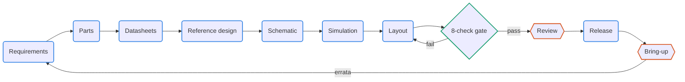

# pcb-pipeline: skills, toolkit and merge gate for open-source PCB design

English | [中文](README.zh-CN.md)

A set of skills for Claude Code and Codex (Agent Skills format) plus pcbkit, a toolkit that is copied into each board project at a fixed version. Together they cover the whole KiCad 10 board flow:

requirements → parts → datasheet facts → official reference design comparison → schematic as code → simulation → rules, placement, routing → gate → review → release



The principles:

- KiCad is the single source of truth for the board.
- Design intent is kept as text.
- Every change passes a deterministic gate in Git and CI.
- Routing uses open routers.
- Agents change a design only through branches, change notes and pull requests.

> **Language.** The skill instructions and the project documents are written in Chinese. Every skill description includes an English sentence to help agents identify relevant tasks in English; automatic selection has not been systematically evaluated.

- How to use it: [docs/SKILLS.zh-CN.md](docs/SKILLS.zh-CN.md) (Chinese). It has an overview diagram, a quick reference for the ten skills, example prompts, the life cycle of one change, the evidence chain and the data flow.
- Why it is designed this way and what was verified: [PIPELINE.zh-CN.md](PIPELINE.zh-CN.md) (Chinese).
- The diagrams are Mermaid, which GitHub renders directly. For other viewers, SVG copies are in `docs/diagrams/`.

It grew out of an earlier survey of AI and EDA tools for hardware design (not part of this repository) and the experience of building a KiCad replica of an ESP32-S3 AMOLED board.

## Skills

| Skill | What it does | Bundled scripts |
| --- | --- | --- |
| `pcb-pipeline` | Orchestrator: stages, artifacts, rules for transactional changes; creates or adopts a project; upgrades pcbkit | `scripts/new_project.py`, `kit/`, `assets/template/` |
| `pcb-parts` | Offline search of the JLCPCB/LCSC parts library, alternates, BOM stock and cost, live prices | `scripts/jlc_parts.py` |
| `pcb-datasheet` | Datasheet download with provenance, per-page search and rendering, `facts.toml` with page references, pinout check against KiCad | `scripts/datasheet.py` |
| `pcb-refdesign` | Export of official reference designs (KiCad, Altium, EAGLE, PDF), chip-centred surroundings, pin-by-pin comparison | `scripts/refnet.py` |
| `pcb-schematic` | SKiDL circuit code → readable KiCad schematic; connectivity intent | (in the project: `pcbkit/sch_gen.py`) |
| `pcb-sim` | SPICE benches, corners and assertions (libngspice) | (in the project: `pcbkit/sim.py`) |
| `pcb-layout` | Board outline, rules, net classes, pours, keepouts; sync, placement, pre-routing; transactional routing with KiCadRoutingTools | `scripts/setup_krt.sh` |
| `pcb-gate` | The 8-check gate, declarative metrics, CI, revision diff and change-scope check | (in the project: `pcbkit/gate.py`, `metrics.py`, `board_diff.py`) |
| `pcb-review` | Review packet (KiCanvas, interactive BOM, PcbDraw drawings, EMC pre-check leads), reviewer plus devil's-advocate passes, findings turned into gate checks | `scripts/setup_kicad_happy.sh` (in the project: `pcbkit/review.py`) |
| `pcb-release` | Fabrication and review package, JLCPCB BOM/CPL, interactive BOM, panelization (the user decides), pre-order checks, tagging | (in the project: `pcbkit/release.py`, `extras.py`) |

The gate runs these 8 checks:

1. ERC.
2. DRC with schematic parity.
3. A rules canary: a broken `.kicad_dru` is otherwise dropped silently.
4. Zone refill.
5. Netlist checks: connectivity intent, pins against pads, BOM fields and the parts register.
6. Board metrics.
7. Simulation assertions.
8. Reproduction of generated files.

## Installing the skills

### 1. Prerequisites

| Needed for | Requirement |
| --- | --- |
| Everything | Linux with KiCad 10 from your distribution: `kicad-cli` and KiCad's `pcbnew` Python module. Tested with Debian's KiCad 10.0.6 and Python 3.14. pcbkit uses the system KiCad and never downloads its own copy |
| Datasheets | poppler-utils (`pdftotext`, `pdfinfo`, `pdftoppm`) |
| Simulation | libngspice (Debian: `libngspice0`, already pulled in by KiCad) |
| Board projects | [uv](https://docs.astral.sh/uv/) for the Python dependency groups (SKiDL, router, optional outputs), and git |
| Tests only | rsync |
| The agent | [Claude Code](https://claude.com/claude-code) and/or Codex |

On Debian or Ubuntu:

```bash
sudo apt install kicad poppler-utils libngspice0 git rsync pipx
pipx install uv          # or the installer from the uv website
```

### 2. Get the repository

```bash
git clone https://github.com/kfihihc/pcb-pipeline.git
cd pcb-pipeline
```

Keep the clone: the skills are installed as symbolic links into it.

### 3. Link the skills

`install.sh` links every folder under `skills/` into the personal skill folders of Claude Code (`~/.claude/skills/`) and Codex (`~/.codex/skills/`). It links only into folders that already exist, so create the ones for the agents you use first:

```bash
mkdir -p ~/.claude/skills     # Claude Code
mkdir -p ~/.codex/skills      # Codex, only if you use it
./install.sh
```

Expected output, once per skill and agent:

```
linked  /home/you/.claude/skills/pcb-pipeline
linked  /home/you/.claude/skills/pcb-parts
...
```

- `skip … (not present)` means that agent's skill folder does not exist; create it and run `./install.sh` again.
- `CONFLICT … exists and is not a link` means a skill of the same name is already installed. The script leaves it untouched; move it away first if you want this one.

Install all ten skills. They refer to each other: the orchestrator hands work to the stage skills, and the release skill uses references from the layout skill.

### 4. Check the installation

```bash
./install.sh --check
```

This lists every link (`ok`, `missing` or `CONFLICT`) and checks the dependencies: `kicad-cli`, poppler, uv, git, libngspice, the parts database, the router and kicad-happy.

Then start a **new** Claude Code session so it loads the skills, and try one of these:

- type `/pcb-pipeline`;
- or just describe the task, for example "Design a small USB-C to 3.3 V board with pcb-pipeline". The agent chooses the skill from its description.

The ten skills have been discovered in both Claude Code and Codex, and their instructions have been read in Codex. This verifies discovery and access, not an end-to-end board design run in both agents.

### 5. One-time downloads (when a stage first needs them)

All of these go to `~/.cache/pcb-pipeline/`, outside the repository:

| For | Command | Notes |
| --- | --- | --- |
| Parts search (`pcb-parts`) | `python3 skills/pcb-parts/scripts/jlc_parts.py fetch --db current` | JLCPCB parts database, about 180 MB |
| Autorouting (`pcb-layout`) | `skills/pcb-layout/scripts/setup_krt.sh` | KiCadRoutingTools v0.22.1 with its own uv environment |
| EMC pre-check (`pcb-review`, optional) | `skills/pcb-review/scripts/setup_kicad_happy.sh` | kicad-happy v2.3.1; only its analysis scripts are used, its skills are not installed |

The optional outputs (KiKit panel, InteractiveHtmlBom, PcbDraw) are installed per board project, in that project's uv environment: run `uv sync --group extras` in the project. `kicanvas.js` ships with pcbkit. [docs/external-tools.zh-CN.md](docs/external-tools.zh-CN.md) (Chinese) explains how these tools were chosen and why KiBot is not used.

### Updating and removing

- **Update the skills:** `git pull` in the clone. The links pick up the change at once; start a new agent session.
- **Update a board project's toolkit:** each project keeps its own copy of pcbkit, so upgrade it deliberately, on its own branch, then run the gate:

  ```bash
  python3 <clone>/skills/pcb-pipeline/scripts/new_project.py <board> --update-kit
  ```
- **Remove:** `./install.sh --uninstall` removes only the links that point into this clone.

### Other ways to install

- **One project only (Claude Code):** link the skill folders into that project's `.claude/skills/` instead of `~/.claude/skills/`.
- **Copy instead of link:** copying `skills/*` also works, but then `git pull` no longer updates them.

## Quick start

```bash
P=$PWD/skills       # run inside the pcb-pipeline clone
python3 "$P/pcb-pipeline/scripts/new_project.py" ~/boards/my-board --name my-board --title "My board" --size 40x30
cd ~/boards/my-board && git init
# then tell Claude Code / Codex: "Design this board with pcb-pipeline. The requirements are ..."
python3 pcbkit/gate.py          # the gate; run it at any time
```

To adopt an existing KiCad project:

```bash
# Run from the pcb-pipeline clone; replace /path/to/existing-board.
python3 skills/pcb-pipeline/scripts/new_project.py /path/to/existing-board \
  --adopt --pcb x.kicad_pcb --sch x.kicad_sch
```

See `examples/s3-adoption/` for a worked case.

## Examples

- [examples/usb-ldo/](examples/usb-ldo/): a small two-layer board taken from nothing to a fabrication package. Its README lists the problems each stage actually caught.
- [examples/s3-adoption/](examples/s3-adoption/): the gate applied to the S3 AMOLED replica, with its 30 existing thresholds rewritten as declarative metrics.

## Tests

```bash
tests/run_tests.sh        # about 2 minutes
```

The suite runs the example's gate and negative tests for each check. It also covers simulation, reference designs, parts search, datasheets, and the optional outputs including panelization. A test whose data or tool is missing is skipped, not failed.

## License

MIT, see [LICENSE](LICENSE). This covers the skills, pcbkit, the documentation and the example designs.

New board projects default to MIT; use `new_project.py --license <identifier>` to choose another license. Check the upstream license when adopting or deriving an existing design.

Exceptions:

- **KiCanvas:** `kicanvas.js` (`skills/pcb-pipeline/kit/vendor/` and its copy in the example) keeps its own MIT license and copyright, in `kicanvas.LICENSE.md` next to it.
- **KiCad libraries:** symbols and footprints from the KiCad libraries used in the example boards are under the KiCad library license (CC-BY-SA 4.0 with an exception for designs that use them).
- **Tools fetched at setup:** these keep their own licenses. All are MIT: KiCadRoutingTools, kicad-happy, KiKit, InteractiveHtmlBom and PcbDraw.
