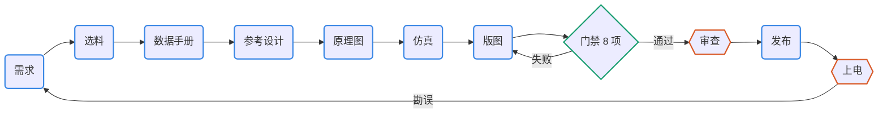

# pcb-pipeline：开源 PCB 设计的技能、工具包与门禁

[English](README.md) | 中文

一套给 Claude Code 和 Codex 用的技能（Agent Skills 格式），加一个随工程固定版本的工具包 pcbkit，覆盖 KiCad 10 电路板设计的完整流程：

需求 → 选料 → 数据手册事实 → 官方参考设计对比 → 原理图即代码 → 仿真 → 规则、摆位、布线 → 门禁 → 审查 → 发布



几条原则：

- KiCad 是版图的唯一真源；
- 设计意图用文本保存；
- 每次改动都要过 Git 和 CI 里的确定性门禁；
- 布线用开源布线器；
- agent 只能通过分支、变更单和 PR 改设计。

相关文档：

- 怎么用：[docs/SKILLS.zh-CN.md](docs/SKILLS.zh-CN.md)（全景图、十个技能速查、示例对话、一次改动的时序、证据链、数据流）；
- 为什么这样设计、验证了什么：[PIPELINE.zh-CN.md](PIPELINE.zh-CN.md)；
- 流程图是 Mermaid，GitHub 会直接显示；其他查看器看 `docs/diagrams/` 下的 SVG。

来源是一份 AI 与 EDA 工具调研报告（不在本仓库）的建议，以及一块 ESP32-S3 AMOLED 板 KiCad 复刻工程的经验。

## 技能

| 技能 | 用途 | 自带脚本 |
| --- | --- | --- |
| `pcb-pipeline` | 总控：阶段、产物、事务化改动规则；新建或接管工程；升级 pcbkit | `scripts/new_project.py`、`kit/`、`assets/template/` |
| `pcb-parts` | 嘉立创/LCSC 元件库离线检索、替代料、BOM 库存与成本、实时价格 | `scripts/jlc_parts.py` |
| `pcb-datasheet` | 数据手册下载与来源记录、逐页检索、渲染、`facts.toml`（带页码）、引脚与 KiCad 比对 | `scripts/datasheet.py` |
| `pcb-refdesign` | 官方参考设计（KiCad、Altium、EAGLE、PDF）导出、以芯片为中心的周边清单、逐脚对比 | `scripts/refnet.py` |
| `pcb-schematic` | SKiDL 电路代码 → 可读的 KiCad 原理图；连接意图 | （工程内 `pcbkit/sch_gen.py`） |
| `pcb-sim` | SPICE 基准、角点、断言（libngspice） | （工程内 `pcbkit/sim.py`） |
| `pcb-layout` | 板框、规则、网络类、铺铜、禁布区；同步、摆位、预布线；KiCadRoutingTools 事务化布线 | `scripts/setup_krt.sh` |
| `pcb-gate` | 8 项门禁、声明式指标、CI、版本对比与范围核对 | （工程内 `pcbkit/gate.py`、`metrics.py`、`board_diff.py`） |
| `pcb-review` | 审查包（含 KiCanvas、交互式 BOM、PcbDraw 板图、EMC 预检线索）、审查者加反方两轮、发现转成门禁项 | `scripts/setup_kicad_happy.sh`（工程内 `pcbkit/review.py`） |
| `pcb-release` | 制造与审查包、嘉立创 BOM/CPL、交互式 BOM、拼板（由用户定）、下单核对、标签 | （工程内 `pcbkit/release.py`、`extras.py`） |

门禁的 8 项检查：

1. ERC；
2. DRC 加原理图一致性；
3. 规则哨兵（`.kicad_dru` 写错会被静默丢弃，哨兵用来发现这种情况）；
4. 铺铜复算；
5. 网表检查：连接意图、引脚对焊盘、BOM 字段、选料登记；
6. 版图指标；
7. 仿真断言；
8. 生成文件复现。

## 安装技能

### 1. 准备

| 用于 | 要求 |
| --- | --- |
| 全部 | Linux，系统包管理器装的 KiCad 10（要有 `kicad-cli` 和 KiCad 的 `pcbnew` Python 模块）。实测环境是 Debian 的 KiCad 10.0.6、Python 3.14。pcbkit 只用系统 KiCad，不会自己下载 |
| 数据手册 | poppler-utils（`pdftotext`、`pdfinfo`、`pdftoppm`） |
| 仿真 | libngspice（Debian 包名 `libngspice0`，装 KiCad 时已带上） |
| 板子工程 | [uv](https://docs.astral.sh/uv/)（管理 SKiDL、布线器、可选输出等 Python 依赖组）、git |
| 仅测试 | rsync |
| agent | Claude Code 或 Codex，两者都用也可以 |

Debian、Ubuntu：

```bash
sudo apt install kicad poppler-utils libngspice0 git rsync pipx
pipx install uv          # 或用 uv 官网的安装脚本
```

### 2. 获取仓库

```bash
git clone https://github.com/kfihihc/pcb-pipeline.git
cd pcb-pipeline
```

技能是以软链接的方式装进去的，链接指向这个目录，所以装完不要删掉它。

### 3. 链接技能

`install.sh` 把 `skills/` 下的每个技能软链接到 Claude Code 的个人技能目录 `~/.claude/skills/` 和 Codex 的 `~/.codex/skills/`。它只链接到已经存在的目录，所以先把要用的那个建好：

```bash
mkdir -p ~/.claude/skills     # Claude Code
mkdir -p ~/.codex/skills      # Codex，用到时才建
./install.sh
```

正常输出，每个技能、每个 agent 各一行：

```
linked  /home/you/.claude/skills/pcb-pipeline
linked  /home/you/.claude/skills/pcb-parts
...
```

- 出现 `skip … (not present)`：说明这个 agent 的技能目录不存在。建好目录后重跑 `./install.sh`。
- 出现 `CONFLICT … exists and is not a link`：说明已经装了同名技能。脚本不会动它；要用这一份，先把旧的移走。

十个技能请全部安装。它们互相引用：总控会把工作转给各阶段的技能，发布技能也会引用版图技能的参考文件。

### 4. 检查

```bash
./install.sh --check
```

它会列出每个链接的状态（`ok`、`missing` 或 `CONFLICT`），并检查依赖：`kicad-cli`、poppler、uv、git、libngspice、选料数据库、布线器和 kicad-happy。

然后**新开**一个 Claude Code 会话，让它加载技能，再试下面任一种：

- 输入 `/pcb-pipeline`；
- 直接说要做的事，例如“按 pcb-pipeline 做一块 USB-C 转 3.3 V 的小板”，agent 会按描述自动选技能。

已确认 Claude Code 和 Codex 都能发现这十个技能，且已在 Codex 中读取技能指令。这验证的是技能发现与读取，不代表两个 agent 都已完成端到端设计验证。

### 5. 首次用到时下载

下面这些都放在仓库外的 `~/.cache/pcb-pipeline/`：

| 用于 | 命令 | 说明 |
| --- | --- | --- |
| 选料（pcb-parts） | `python3 skills/pcb-parts/scripts/jlc_parts.py fetch --db current` | 嘉立创元件库，约 180 MB |
| 自动布线（pcb-layout） | `skills/pcb-layout/scripts/setup_krt.sh` | KiCadRoutingTools v0.22.1，自带 uv 环境 |
| EMC 预检（pcb-review，可选） | `skills/pcb-review/scripts/setup_kicad_happy.sh` | kicad-happy v2.3.1，只用它的分析脚本，不装它的技能 |

可选输出用的 KiKit（拼板）、InteractiveHtmlBom、PcbDraw 按工程安装，装在各工程自己的 uv 环境里：在工程目录里运行 `uv sync --group extras`。`kicanvas.js` 随 pcbkit 入库。外部工具怎样选的、为什么不用 KiBot，见 [docs/external-tools.zh-CN.md](docs/external-tools.zh-CN.md)。

### 更新与卸载

- **更新技能**：在仓库里 `git pull`，链接立即生效，新开一个 agent 会话即可。
- **更新工程里的工具包**：每个工程带着自己的一份 pcbkit。要单独开分支升级，然后跑门禁：

  ```bash
  python3 <仓库>/skills/pcb-pipeline/scripts/new_project.py <工程目录> --update-kit
  ```
- **卸载**：`./install.sh --uninstall`，只删除指向本仓库的链接。

### 其他装法

- **只给某个工程用（Claude Code）**：把技能目录链接到该工程的 `.claude/skills/` 下，不放进 `~/.claude/skills/`。
- **复制而不是链接**：直接复制 `skills/*` 也能用，但之后 `git pull` 就更新不到了。

## 快速开始

```bash
P=$PWD/skills       # 在 pcb-pipeline 仓库目录里执行
python3 "$P/pcb-pipeline/scripts/new_project.py" ~/boards/my-board --name my-board --title "My board" --size 40x30
cd ~/boards/my-board && git init
# 之后在 Claude Code / Codex 里说：“按 pcb-pipeline 做这块板，需求是……”
python3 pcbkit/gate.py          # 随时可以跑的门禁
```

接管已有的 KiCad 工程（在 pcb-pipeline 仓库目录执行，将路径替换为实际工程目录）：

```bash
python3 skills/pcb-pipeline/scripts/new_project.py /path/to/existing-board \
  --adopt --pcb x.kicad_pcb --sch x.kicad_sch
```

参考 `examples/s3-adoption/`。

## 示例

- [examples/usb-ldo/](examples/usb-ldo/)：从零做到制造包的双层小板，展示每个阶段实际拦下的问题。
- [examples/s3-adoption/](examples/s3-adoption/)：把门禁套到 S3 AMOLED 复刻工程上，30 条原有阈值改写成声明式指标。

## 测试

```bash
tests/run_tests.sh        # 冒烟测试：示例工程门禁、各类反向测试、仿真、参考设计、选料与数据手册、可选输出与拼板（约 2 分钟）
```

缺数据或缺工具的测试会跳过，不算失败。

## 许可

MIT，见 [LICENSE](LICENSE)。适用于技能、pcbkit、文档和示例设计。

新建板子工程默认 MIT，可用 `new_project.py --license <标识>` 指定其他许可；接管或派生已有设计时先核对上游许可。

例外：

- **KiCanvas**：`kicanvas.js`（`skills/pcb-pipeline/kit/vendor/`，以及示例里的副本）保留它自己的 MIT 许可和版权声明，见同目录的 `kicanvas.LICENSE.md`。
- **KiCad 库**：示例板用到的 KiCad 库符号和封装，按 KiCad 库的许可（CC-BY-SA 4.0，对使用它们的设计有例外条款）。
- **安装时下载的工具**：各自保留原许可，都是 MIT：KiCadRoutingTools、kicad-happy、KiKit、InteractiveHtmlBom、PcbDraw。
