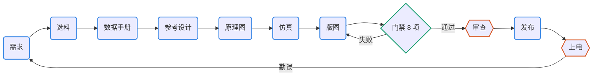

# pcb-pipeline：开源 PCB 设计的技能、工具包与门禁

一套给 Claude Code 和 Codex 用的技能（Agent Skills 格式），加一个随工程固定版本的工具包 pcbkit，覆盖 KiCad 10 电路板设计的完整流程：

需求 → 选料 → 数据手册事实 → 官方参考设计对比 → 原理图即代码 → 仿真 → 规则、摆位、布线 → 门禁 → 审查 → 发布



- 怎么用：[docs/SKILLS.zh-CN.md](docs/SKILLS.zh-CN.md)（全景图、十个技能速查、示例对话、一次改动的时序、证据链、数据流）；
- 为什么这样设计、验证了什么：[PIPELINE.zh-CN.md](PIPELINE.zh-CN.md)；
- 流程图是 Mermaid，Gitea 和 GitHub 会直接显示；其他查看器看 `docs/diagrams/` 下的 SVG。

来源是 `../hardware-agent-research/ANALYSIS.zh-CN.md` 的建议和 S3 复刻工程的经验。

## 技能

| 技能 | 用途 | 自带脚本 |
| --- | --- | --- |
| `pcb-pipeline` | 总控：阶段、产物、事务化改动规则；新建或接管工程；升级 pcbkit | `scripts/new_project.py`、`kit/`、`assets/template/` |
| `pcb-parts` | 嘉立创/LCSC 元件库离线检索、替代料、BOM 库存与成本、实时价格 | `scripts/jlc_parts.py` |
| `pcb-datasheet` | 数据手册下载与来源记录、逐页检索、渲染、`facts.toml`（带页码）、引脚与 KiCad 比对 | `scripts/datasheet.py` |
| `pcb-refdesign` | 官方参考设计（KiCad、Altium、EAGLE、PDF）导出、以芯片为中心的周边清单、逐脚对比 | `scripts/refnet.py` |
| `pcb-schematic` | SKiDL 电路代码 → 可读的 KiCad 原理图；连接意图 | （工程内 `pcbkit/sch_gen.py`） |
| `pcb-sim` | SPICE 基准、角点、断言（libngspice） | （工程内 `pcbkit/sim.py`） |
| `pcb-layout` | 板框、规则、网络类、铺铜、禁布区；同步、摆位、预布线；KiCadRoutingTools 事务化布线 | `scripts/setup_krt.sh` |
| `pcb-gate` | 8 项门禁、声明式指标、CI、版本对比与范围核对 | （工程内 `pcbkit/gate.py`、`metrics.py`、`board_diff.py`） |
| `pcb-review` | 审查包（含 KiCanvas、交互式 BOM、PcbDraw 板图、EMC 预检线索）、审查者加反方两轮、发现转成门禁项 | `scripts/setup_kicad_happy.sh`（工程内 `pcbkit/review.py`） |
| `pcb-release` | 制造与审查包、嘉立创 BOM/CPL、交互式 BOM、拼板（由用户定）、下单核对、标签 | （工程内 `pcbkit/release.py`、`extras.py`） |

## 安装

```bash
cd /home/moyu/idea/pcb-pipeline
./install.sh            # 把 skills/* 软链接到 ~/.claude/skills/ 和 ~/.codex/skills/（目录存在才链接）
./install.sh --check    # 查看链接状态和依赖
./install.sh --uninstall
```

依赖：

- 系统 KiCad 10、poppler-utils，均已装；
- uv（`~/.local/bin/uv`）；
- 选料数据库首次使用前下载：`python3 skills/pcb-parts/scripts/jlc_parts.py fetch --db current`（约 180 MB）；
- 布线器首次使用前安装：`skills/pcb-layout/scripts/setup_krt.sh`；
- EMC 预检（可选）首次使用前安装：`skills/pcb-review/scripts/setup_kicad_happy.sh`。

这三样下载都放在 `~/.cache/pcb-pipeline/`。可选输出用的 KiKit、InteractiveHtmlBom、PcbDraw 装在各工程自己的 uv 环境里（`uv sync --group extras`）；`kicanvas.js` 随 pcbkit 入库。外部工具怎样选的、为什么不用 KiBot，见 [docs/external-tools.zh-CN.md](docs/external-tools.zh-CN.md)。

## 快速开始

```bash
P=/home/moyu/idea/pcb-pipeline/skills
python3 $P/pcb-pipeline/scripts/new_project.py ~/idea/my-board --name my-board --title "My board" --size 40x30
cd ~/idea/my-board && git init
# 之后在 Claude Code / Codex 里说：“按 pcb-pipeline 做这块板，需求是……”
python3 pcbkit/gate.py          # 随时可以跑的门禁
```

接管已有的 KiCad 工程：`new_project.py <目录> --adopt --pcb x.kicad_pcb --sch x.kicad_sch`，参考 `examples/s3-adoption/`。

## 示例

- [examples/usb-ldo/](examples/usb-ldo/)：从零做到制造包的双层小板，展示每个阶段实际拦下的问题。
- [examples/s3-adoption/](examples/s3-adoption/)：把门禁套到 S3 AMOLED 复刻工程上，30 条原有阈值改写成声明式指标。

## 测试

```bash
tests/run_tests.sh        # 冒烟测试：示例工程门禁、各类反向测试、仿真、参考设计、选料与数据手册、可选输出与拼板（约 2 分钟）
```
