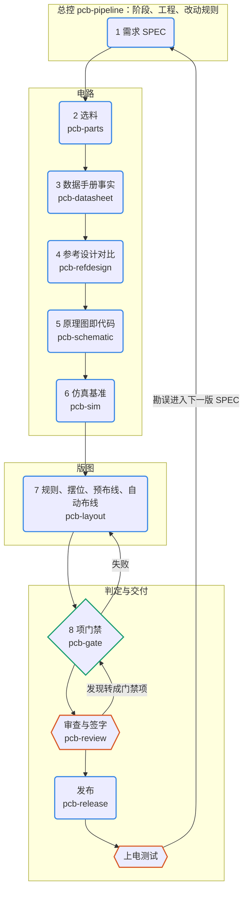
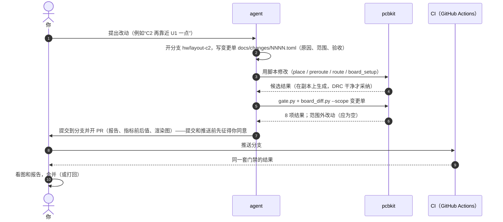
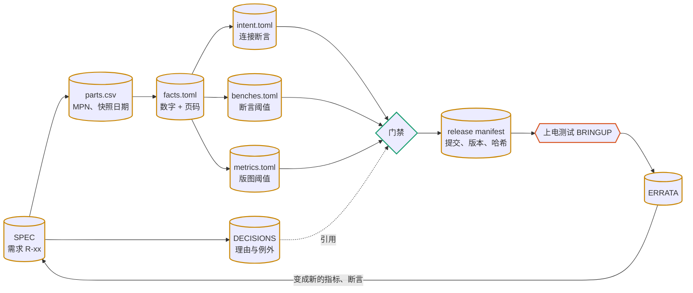
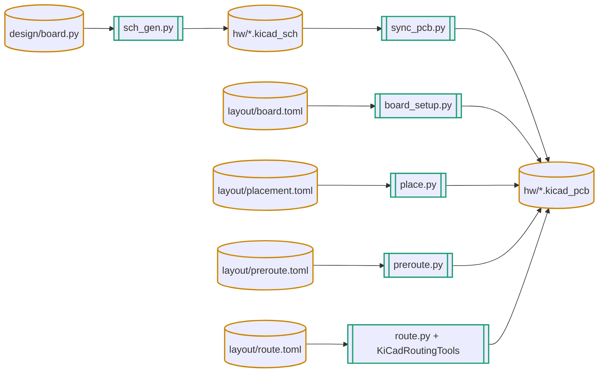
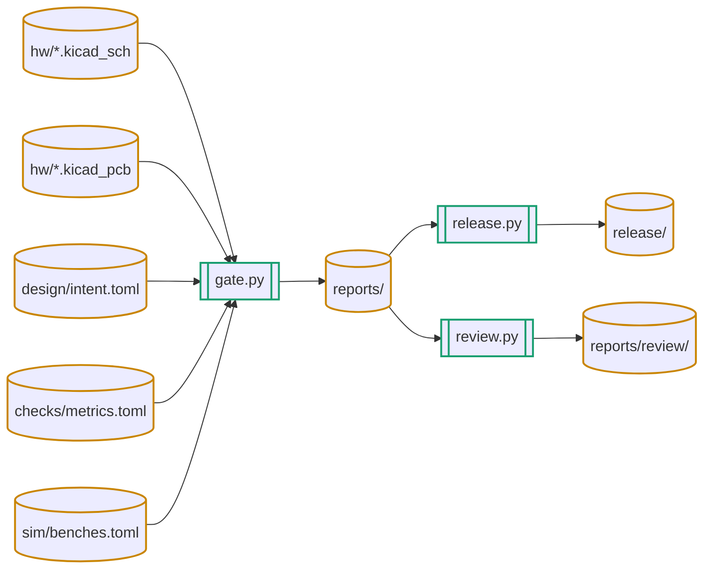

# 技能使用说明

这 10 个技能都写成通用的 SKILL.md（Agent Skills 格式），装在 `~/.claude/skills/` 和 `~/.codex/skills/`（`./install.sh`）。平时不用记技能名：在 Claude Code 或 Codex 里直接说要做的事，agent 会按描述自动选技能；也可以点名，例如“用 pcb-review 看一下这块板”。

本文的流程图是 Mermaid 代码，GitHub、Typora、Obsidian 会直接显示；其他查看器可以看 `docs/diagrams/` 下同名的 SVG（`python3 tools/diagrams.py --out docs/diagrams docs/*.md` 重新生成）。

## 1. 全景

图例：蓝色圆角框是 agent 主导的步骤，青绿菱形是确定性检查，橙色六边形必须有人参与。

## 2. 十个技能

每个技能的说明都是同一个结构：何时用、输入与产物、流程图、命令、步骤、要点与常见坑、参考文件。下表是速查，“可以这样说”是能触发它的典型说法。

| 技能 | 做什么 | 主要产物 | 可以这样说 |
| --- | --- | --- | --- |
| `pcb-pipeline` | 总控：阶段、工程结构、改动规则；新建或接管工程 | `pcb.toml`、`docs/`、`pcbkit/`、变更单 | “新建一块 USB 转 3.3 V 的小板”“接管这个 KiCad 工程”“下一步该做什么” |
| `pcb-parts` | 嘉立创元件库离线检索、替代料、库存与成本 | `parts/parts.csv`、DECISIONS | “找一个 SOT-23 的 3.3 V LDO，基础库优先”“这份 BOM 做 10 套多少钱” |
| `pcb-datasheet` | 数据手册 → 带页码的事实，引脚对 KiCad 核对 | `data/parts/<MPN>/facts.toml` | “整理 HT7533-1 的数据手册”“这个连接器的引脚和 KiCad 封装对得上吗” |
| `pcb-refdesign` | 官方参考设计导出、以芯片为中心逐脚对比 | `refs/<名>/` | “RP2040 外围照官方最小系统来，对比一下我的原理图” |
| `pcb-schematic` | SKiDL 电路代码 → 可读的 KiCad 原理图；连接意图 | `design/`、`hw/*.kicad_sch` | “加一个 I2C 温度传感器”“把 CC 电阻改成 5.1k” |
| `pcb-sim` | SPICE 基准、角点、断言 | `sim/` | “热插拔会不会把 LDO 打坏”“LED 电流在最坏情况下多少” |
| `pcb-layout` | 板框、规则、铺铜、禁布区；同步、摆位、预布线、事务化自动布线 | `layout/*.toml`、`.kicad_pcb` | “USB-C 放左边、排针放右边，然后布线”“DRC 报 clearance 怎么办” |
| `pcb-gate` | 8 项门禁、声明式指标、CI、版本对比 | `reports/`、`checks/metrics.toml` | “检查一下能不能合并”“给 USB 线长加个上限”“对比两版改了什么” |
| `pcb-review` | 审查包（含浏览器看图、交互式 BOM、EMC 预检线索）、审查者加反方两轮、发现转门禁 | `docs/reviews/` | “打样前帮我审一下这块板”“EMC 有没有明显问题” |
| `pcb-release` | 制造与审查包、嘉立创 BOM/CPL、交互式 BOM、拼板（由你定）、下单核对 | `release/<名>-<版本>/` | “出 Gerber 准备在嘉立创下单”“拼成 2×1 再下单” |

## 3. 一块新板从头到尾

以 `examples/usb-ldo` 为例，每一步对 agent 说什么、得到什么：

| 步骤 | 你说 | agent 做的事（技能） | 落到哪里 |
| --- | --- | --- | --- |
| 1 | “新建一块 25×18 的板：USB-C 取电，3.3 V 输出 50 mA，带指示灯和排针” | 建工程，把需求整理成 R-01…R-07，列出未决问题（pcb-pipeline） | `docs/SPEC.md` |
| 2 | “选料” | 检索候选、核库存和价格，登记（pcb-parts） | `parts/parts.csv` |
| 3 | “核对关键器件的数据手册” | 下载、按页摘事实、对 KiCad 引脚（pcb-datasheet） | `data/parts/*/facts.toml` |
| 4 | “热插拔有没有问题” | 写热插拔基准，跑角点（pcb-sim），否决了 XC6206 | `sim/`、DECISIONS D-0002 |
| 5 | “画原理图” | SKiDL 代码 → 原理图，写连接意图，过门禁（pcb-schematic） | `design/`、`hw/` |
| 6 | “摆位布线” | 板框规则 → 同步 → 摆位 → 预布线 → 自动布线（pcb-layout） | `layout/`、`hw/*.kicad_pcb` |
| 7 | “检查一下” | 8 项门禁（pcb-gate） | `reports/` |
| 8 | “审一下” | 审查包、两轮审查，逐条核实 EMC 预检线索（pcb-review） | `docs/reviews/` |
| 9 | “出制造文件” | 先问你自己拼板还是交给板厂，再出制造包和下单核对清单（pcb-release） | `release/`、DECISIONS D-0006 |

中途任何改动都走第 4 节的事务流程；需要你拍板的地方（需求冲突、放宽阈值、花钱、发布），agent 会停下来问。

## 4. 改已有设计：一次改动的生命周期

规则要点（详见 `skills/pcb-pipeline/references/change-control.md`）：

- agent 不推送、不合并、不打标签；
- 不为了过检放宽阈值或加例外；确需放宽时停下来问，并写 DECISIONS；
- 布线器、摆位等自动化只在副本上运行，结果过了 DRC 才采纳；
- 锁定的器件和走线，只有变更单写明才能动。

## 5. 证据怎样串起来

每个数字都能顺着这条链找到出处：数据手册页码、仿真基准 id、带日期的价格快照，或需求编号。审查时看不到出处的数字和例外，一律打回。

## 6. 哪些文件喂给哪个工具

设计文件怎样变成 PCB：

哪些文件喂给检查和输出：

`release.py` 和 `review.py` 都会先跑一遍门禁，再从同一份板子和原理图导出各自的内容；门禁失败时 `release.py` 拒绝生成制造包。

两者都会调用 `pcbkit/extras.py` 生成可选输出。这些输出都不进门禁，由 `pcb.toml` 的 `[outputs]` 控制；工具没装时跳过，并在包里写明。去向如下：

| 输出 | 发布包 | 审查包 | 工具 |
| --- | --- | --- | --- |
| KiCanvas：浏览器看原理图和 PCB | `review/kicanvas/` | `kicanvas/` | 随 pcbkit 入库的 `kicanvas.js` |
| 交互式 BOM | `assembly/ibom.html` | `ibom.html` | InteractiveHtmlBom（extras 组） |
| PcbDraw 板图 | — | `pcbdraw-*.svg` | PcbDraw（extras 组） |
| EMC 预检线索 | — | `emc.md`、`emc.json` | kicad-happy 的脚本（`setup_kicad_happy.sh`） |
| 拼板 | `fab/panel/`（`panel = "self"`） | `panel/` | KiKit（extras 组） |

拼板方式（自己拼还是交给板厂）由你决定，agent 在 `panel = "ask"` 时会停下来问；自己拼时，拼板必须是一整块、拼板 DRC 必须干净，否则 `release.py` 拒绝生成。

## 7. Claude Code 与 Codex

- 两边用的是同一份技能目录（软链接），改一处两边都生效。
- Claude Code 会在技能被调用时给出技能目录（“Base directory for this skill”），说明里的 `<本技能目录>` 指的就是它。Codex 直接从技能列表里的路径读取。
- 工程里的命令（`python3 pcbkit/...`）与技能目录无关，人和 CI 也直接用。
- 已验证：Claude Code 能加载这 10 个技能（会话的技能列表里出现）。Codex 端未实测。
