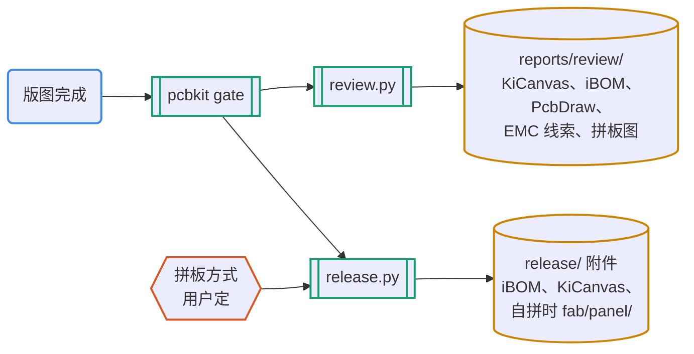

# 外部工具集成

2026-10-10 调研和试跑，2026-10-11 按决定接入 pcbkit。本机环境：KiCad 10.0.6（Debian）、Python 3.14。

来源：

- [awesome-kicad](https://github.com/joanbono/awesome-kicad)（2026-10-01 更新，约 60 项）；
- 各仓库的 README 与 GitHub 发布记录；
- 本机实测。试跑用的是 `/tmp` 下的临时 uv 环境和 `examples/usb-ldo` 的副本；接入后的结果来自示例工程本身和 `tests/run_tests.sh`。

## 0. 决定与落实（2026-10-11）

| 问题 | 决定 | 落实 |
| --- | --- | --- |
| 拼板 | 做成可选，提示用户 | `pcb.toml` 的 `[outputs].panel` 取 `"self"`、`"fab"` 或 `"ask"`（模板默认）。`"ask"` 时 `release.py` 醒目提示并写进 README.txt，不阻断；pcb-release 技能要求 agent 停下来问，用户定了写 DECISIONS。`"self"` 时按 `layout/panel.toml` 用 KiKit 拼，拼板必须是一整块、拼板 DRC 必须干净，否则拒绝发布 |
| iBOM、KiCanvas 放哪里 | 发布包和审查包都放 | 发布包：`assembly/ibom.html`、`review/kicanvas/`；审查包：`ibom.html`、`kicanvas/` |
| `kicanvas.js` | 放进仓库 | `skills/pcb-pipeline/kit/vendor/`，随 pcbkit 复制进每个工程；README 记来源、日期、大小、SHA-256，附许可文件；测试核对哈希 |
| KiBot | 不引入 | — |
| kicad-happy EMC | 接，只用脚本 | `skills/pcb-review/scripts/setup_kicad_happy.sh` 装固定版本 v2.3.1（校验提交号）到 `~/.cache/pcb-pipeline/`，不装它的技能；审查包加 `emc.md`、`emc.json`，只作线索 |

实现方式是原来的方案 A（pcbkit 薄封装），pcbkit 升到 0.2.0：

- `pcbkit/extras.py`：`kicanvas`、`ibom`、`pcbdraw`、`panel`、`emc`、`status` 六个子命令。Python 工具在工程 uv 环境里运行，先加载 kicad_compat；工具没装时抛出“未安装”并给出安装命令，由 `release.py`、`review.py` 记成跳过，不改变包的状态。
- 工程 `pyproject.toml` 加 `extras` 依赖组（kikit、pcbdraw、InteractiveHtmlBom），用 uv 的 `override-dependencies` 去掉 iBOM 声明的 wxPython。它不是默认组，CI 的复现检查不会多装；CI 的 release 任务会先 `uv sync --group extras`。
- 公共的 Gerber 和贴片导出移到 `common.py`，单板和拼板用同一套。
- 示例工程按 D-0006 自拼 2×1；测试从 17 项增加到 27 项（见第 6 节）。

## 1. 评估标准

| 标准 | 为什么 |
| --- | --- |
| KiCad 10 兼容（本机实测） | 本机和 CI 都是 10.0.6；工具不支持就不能用 |
| 无界面运行 | agent 和 CI 都没有显示器 |
| 安装可控 | 只用系统 KiCad；Python 依赖由 uv 管理并锁定版本；不自动下载私有副本 |
| 许可 | MIT、Apache 最省事；GPL/AGPL 只作为外部命令调用，不改不分发也可以，但要记录 |
| 输出可复现 | 进仓库的生成物必须逐字节可复现；只作附件的可以带时间戳 |
| 与 pcbkit 的关系 | 补位优先，重叠的不引入 |

## 2. 实测结果（试跑时）

| 工具 | 版本（发布日期） | 许可 | KiCad 10 | 本机实测 | 用时 | 问题 |
| --- | --- | --- | --- | --- | --- | --- |
| InteractiveHtmlBom | 2.12.0（2026-09-10） | MIT | 2.11.1 起支持 | ✓ 生成交互式 BOM，带 MPN、LCSC 列，正反面视图 | 0.5 s | pip 包依赖 wxPython，从源码编译会失败：用 `--no-deps` 装，借用系统 wx 4.2.5；必须设 `INTERACTIVE_HTML_BOM_NO_DISPLAY=1`；页面带生成时间 |
| KiKit | 1.8.1（2026-08-05） | MIT | 1.8.0 起支持（不再支持 KiCad 9 以前） | ✓ 2×2 拼板（邮票孔、上下工艺边、定位孔、光学点）；✓ `fab jlcpcb` 出 Gerber、BOM、CPL | 1.0 s / 1.7 s | 直接运行报 `SwigPyIterator … no attribute 'next'`，加载 kicad_compat 后正常；输出目录要先建好；拼板 DRC 报 8 项邮票孔落进 J1 庭院，以及 36 项缺库表 |
| PcbDraw | 1.3.0（2026-08-07） | MIT | 1.2.0 起支持 | ✓ 风格化 2D 板图（SVG） | 2.9 s | 同样要加载 kicad_compat；自带器件图库没有 USB-C 和 SOT-89，这两个只画出焊盘 |
| KiCanvas | 无正式发版（最后推送 2026-04-28） | MIT | 未声明，README 只说 KiCad 6 及以后 | ✓ 浏览器里正确显示示例的 KiCad 10 原理图（全局标签、符号、标题栏）和 PCB | — | 自称“早期 alpha”；要通过 HTTP 打开，`file://` 读不了文件；脚本 477 KB，来自 kicanvas.org |
| KiBot | 1.9.1（2026-07-28） | AGPL-3.0 | 1.9 支持 KiCad 10（经 kicad-cli） | △ Gerber 正常；iBOM 输出失败 | 4.4 s | 只认它自己维护的 iBOM 分支，找不到就尝试自动下载；同样要加载 kicad_compat |

拼板实测图（2×2）：右侧两块板的 USB-C 朝左，外壳伸出板边，伸进了与左侧板之间 2 mm 的间隙，正好压在那排邮票孔上。DRC 报了 `npth_inside_courtyard`。带悬伸连接器的板子拼板时，要让连接器那一侧朝外，或者那一侧不放连接桥。示例因此改成 2×1、只在上下边放连接桥（D-0006）。

## 3. 放在流程的哪里

| 阶段 | 工具 | 用途 | 进门禁吗 |
| --- | --- | --- | --- |
| 审查、发布 | KiCanvas | 审查包和发布包都加 `kicanvas/index.html`，用浏览器看原理图和 PCB，不用装 KiCad | 否 |
| 审查、文档 | PcbDraw | README 和引脚说明用的板图 | 否 |
| 发布、审查 | InteractiveHtmlBom | 装配和返修时按位号找器件 | 否 |
| 审查 | kicad-happy（脚本） | EMC 规则式预检，进审查包 | 否，只作线索 |
| 发布（可选） | KiKit | 拼板（用户选自拼时） | 拼板本身要过 DRC，外框必须只有一块 |
| 审查（以后） | kiri | 原理图和 PCB 按 git 版本做可视化对比 | 否；它依赖的 KiCad-Diff 2024 年起没有更新，KiCad 10 兼容性未知 |

## 4. 其他值得一提的

| 工具 | 许可 | 和我们的关系 | 看法 |
| --- | --- | --- | --- |
| [kicad-happy](https://github.com/aklofas/kicad-happy) | MIT | 11 个 Claude Code/Codex 技能：KiCad 分析、SPICE、**EMC 预检（44 条规则）**、数据手册、BOM、DigiKey/Mouser/LCSC/element14、嘉立创/PCBWay；纯 Python 解析，不需要装 KiCad | 和我们大量重叠，两套技能同时装会抢触发。**已接入**它的 EMC 分析脚本（v2.3.1），作为审查包的线索；不装它的技能。usb-ldo 4 条发现，S3 92 条（7 秒） |
| [gerber2ems](https://github.com/antmicro/gerber2ems)、[kicad-rfsim](https://github.com/NBalciunas/kicad-rfsim) | Apache-2.0 / MIT | 用 openEMS 做走线 SI 和射频仿真；rfsim 明确支持 KiCad 10 | 仿真阶段目前只有 SPICE。S3 的射频馈线、USB 差分可以用它们补，属于中期事项 |
| [uConfig](https://github.com/Robotips/uConfig) | GPL-3.0 | 从 PDF 提取引脚表，生成 KiCad 符号 | 可以辅助数据手册阶段（引脚多的芯片），结果仍要用 `datasheet.py check` 核对 |
| [kicad-python](https://gitlab.com/kicad/code/kicad-python) | MIT | KiCad 官方 IPC API 绑定 | SWIG 版 pcbnew 将来会被废弃，pcbkit 迟早要迁过去。IPC API 需要 KiCad 进程在运行，无界面 CI 怎么用要先验证 |
| [akcli](https://github.com/tipoLi5890/akcli) | MIT | 用 JSON 操作列表改 `.kicad_sch`，带网表差异安全门 | 思路和我们的连接意图、范围核对一致；项目很新（9 星），先观察 |
| KiCost、KiABOM | MIT 等 | 多分销商 BOM 成本 | 我们目前只查嘉立创/LCSC；要上 DigiKey/Mouser 时再看 |
| JLCKicadTools | GPL-3.0 | 嘉立创旋转修正表 | 2025-05 起没有更新；KiKit 和 kicad-jlcpcb-tools 都有类似的表 |
| altium2kicad | GPL-2.0 | Altium 原理图和 PCB 转 KiCad | 仓库已归档；PCB 用 `kicad-cli pcb import` 就够 |

## 5. 集成方式的三种选择（选了 A）

| 方案 | 做法 | 好处 | 代价 |
| --- | --- | --- | --- |
| **A. pcbkit 薄封装（已采用）** | 工程 `pyproject.toml` 加可选组 `extras`（kikit、pcbdraw、InteractiveHtmlBom，后者不装依赖、借用系统 wx）；pcbkit 新增 `extras.py`（先加载 kicad_compat，再设无界面环境变量）；`release.py --ibom`、`review.py --kicanvas --pcbdraw`、`panel.py` | 版本由 uv.lock 锁定；KiCad 10 的补丁集中在一处；仍然只用系统 KiCad | 每个工具要写一层封装和测试；InteractiveHtmlBom 的 wxPython 依赖用 uv 的依赖覆盖排除，已验证 |
| B. KiBot 作输出引擎 | 用 KiBot 的 YAML 取代 release.py 的导出部分 | 一份配置覆盖几十种输出 | AGPL；依赖由它自己管、会自动下载；要绕过它的 iBOM 分支要求；和门禁、发布重叠 |
| C. 只写进文档 | 技能里说明怎样手动运行这些工具 | 不增加维护 | 每次都要人或 agent 自己处理 KiCad 10 补丁和参数，结果不稳定 |

## 6. 接入后的验证

`tests/run_tests.sh` 新增 10 项，全部通过：

| 测试 | 内容 |
| --- | --- |
| `kit_vendor_files_match_readme` | `kicanvas.js` 的大小和 SHA-256 与 vendor/README 一致 |
| `extras_kicanvas_page` | 页面有原理图和 PCB 两个查看器，带上了工程文件和同一份脚本 |
| `extras_ibom` | 生成交互式 BOM |
| `extras_pcbdraw_svg` | 正反面 SVG 都是合法 XML |
| `extras_panel_one_piece_drc_clean` | 示例 2×1 拼板外框一块、DRC 0 违规，有渲染图 |
| `negative_panel_without_tabs` | 去掉连接桥（`vcount = 0`）后，`extras.py panel` 必须失败 |
| `release_self_panel_ibom_kicanvas` | 发布包有拼板 Gerber、18 行拼板 CPL、iBOM，SHA256SUMS 全部校验通过 |
| `release_package_review_only` | `panel = "ask"`、没装 extras 时仍能出包，README 写明“拼板未定”和“iBOM 跳过” |
| `negative_release_self_panel_without_kikit` | 选了自拼但没装 KiKit 时拒绝发布，且不留下半成品目录 |
| `review_packet_optional_outputs`、`extras_emc_kicad_happy` | 审查包各节齐全；EMC 报告含 IO-001 |

接入时又查出的问题（都已写进 `skills/pcb-pipeline/references/kicad10-notes.md`）：

- **悬空拼板**：试跑时以为 2×1 拼板“DRC 干净”就算成功，看渲染图才发现一个连接桥都没有，板子在拼板里是悬空的。原因是 KiKit 的 `hcount` 指左右边，`vcount` 才是上下边，而 `fixed` 类型的宽度要用 `vwidth`、`hwidth`。现在 `extras.py panel` 另外检查拼板外框只有一块。
- **拼板位号**：KiKit 的拼板 CPL 里，每块子板重复同一位号，BOM 用单板的，这是 KiKit 文档写明的用法。用 `layout.renameref` 改名后，位号与原理图对不上，输出的 BOM 和 CPL 是空的。嘉立创是否接受重复位号，要在下单的贴片预览里确认，已写进 pcb-release 的核对步骤。
- **KiCanvas 离线**：图纸照常显示，工具栏图标会变成文字（图标字体从 fonts.googleapis.com 加载）。
- **iBOM**：包一导入就 `import pcbnew`，判断是否已安装时只能用 `find_spec`。

## 7. 以后

- kiri（按 git 版本做可视化对比）：它依赖的 KiCad-Diff 2024 年以来没有更新，要先验证 KiCad 10 兼容性。
- gerber2ems、kicad-rfsim：S3 的射频馈线和 USB 差分的 SI 仿真，属于中期事项。
- kicad-python（IPC API）：SWIG 版 pcbnew 将来会被废弃，要先验证无界面 CI 能不能用。
- kicad-happy 的其他分析（SPICE、热、多分销商 BOM）和本套重叠，暂不接。
