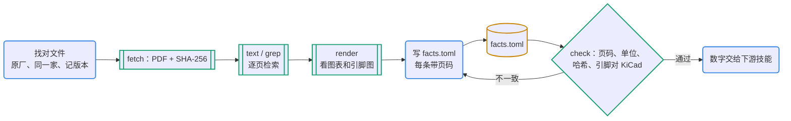

# 数据手册 → 带页码的事实

数据手册是设计的证据。这一步的产物 `facts.toml` 给选料、原理图（连接意图）、仿真（断言阈值）、版图（布局建议）和审查提供依据。规矩只有一条：每个数字都带页码，指向一份记录了 SHA-256 的 PDF。

## 何时用

- 读 datasheet、核对引脚定义、找绝对最大值和推荐工作条件、看典型应用电路或布局要求。
- 怀疑仿制件或同名件参数不同。
- 参考设计（整板原理图）的阅读转给 pcb-refdesign。

## 输入与产物

| 项 | 内容 |
| --- | --- |
| 输入 | MPN 或 LCSC 号，或数据手册链接 |
| 产物 | `data/parts/<MPN>/`：`datasheet.pdf`、`source.json`（链接、日期、SHA-256、页数）、`pages/`（逐页文本与渲染图，不入库）、`facts.toml` |
| 验收 | `datasheet.py check` 无问题：页码在范围内、单位齐全、哈希一致、引脚与 KiCad 符号和封装一一对应 |
| 下一步 | 绝对最大值 → pcb-sim 断言；典型应用 → pcb-schematic 连接意图、pcb-refdesign 对比；布局建议 → pcb-layout 指标；注意事项 → 审查和上电测试 |

## 流程



图例：蓝色圆角框是 agent，青绿框和菱形是工具与检查，黄色圆柱是文件。

## 命令

```bash
D=<本技能目录>/scripts/datasheet.py
python3 $D fetch C14289 --root data/parts                     # LCSC 号：先用 LCSC 的 PDF 直链，再用零件库链接
python3 $D fetch https://.../ds.pdf --mpn HT7533-1 --root data/parts   # 原厂或其他托管链接
python3 $D text data/parts/HT7533-1                          # 逐页文本 pages/NNN.txt，并报告没有文字层的页
python3 $D grep data/parts/HT7533-1 "Absolute Maximum" VIN --context 8
python3 $D render data/parts/HT7533-1 2 12 --dpi 100         # pages/pNNN.png，然后直接看图片
python3 $D pins Regulator_Linear:HT75xx-1-SOT89              # KiCad 符号的引脚号、名字和类型
python3 $D check data/parts/HT7533-1/facts.toml              # 页码、单位、哈希，引脚对 [kicad] 中的符号和封装
```

## 步骤

1. **找对文件**：优先原厂网站的最新版；分销商托管的文件要核对文件里的厂名、型号和版本。`fetch` 自动下载失败时（网页查看器、CDN 拦截），请用户手动下载放进目录，再运行 `text`。
2. **抽文本，检索要点**：绝对最大值、推荐工作条件、电气特性表、引脚说明、应用电路、布局建议、勘误。引脚图、封装尺寸、应用电路多是矢量图形，没有文字层（`text` 会报告这些页），要 `render` 成图片来看。
3. **写 `facts.toml`**（格式见 `references/facts-format.md`），只写本设计用得到的，宁少勿错：每条有 `page`，数值项有 `unit`；保证值（min/max）和典型值（typ）分开，设计只依赖保证值；与分销商描述、标题或常识不一致的地方写成 `[[caveat]]`。
4. **核对 KiCad**：在 `[kicad]` 写 symbol 和 footprint，运行 `check`，引脚号、引脚名和焊盘一一对应。
5. **交付**：把关键数字交给下游技能（见“输入与产物”的下一步）。

## 要点与常见坑

- **同名不同厂**：示例中，立创中文站给 HT75xx-1 的 PDF 是另一家厂商的（36 V、8 页），Holtek 原厂的是 30 V、18 页。用错了，后面的事实全部作废。
- **标题里的数字多是典型值**：HT7533-1 首页写 100 mA，表里的保证值是 70 mA。以电气特性表的 min/max 为准。
- 绝对最大值不能当工作条件，裕量按推荐工作条件算。
- 应用电路的电容画成有极性的（钽或电解），又没给 ESR 范围时，换陶瓷电容不在手册覆盖范围内：写 caveat，安排负载阶跃测试。
- **编号约定可能与 KiCad 相反**：KT-0603R 原厂 1 = 阳极，KiCad 的 LED 1 = 阴极。写成 caveat，转给版图和发布阶段核对极性。
- 机械图要读：推荐焊盘对应的板厚、外壳和插脚长度、pin 1 和极性标记、禁布区。
- pdftotext 会把单词粘在一起（“AbsolutemAximum”），`grep` 已允许词间空白可有可无，必要时换个关键词。
- 许可：数据手册一般不允许再分发。公开仓库只放 `source.json`，不放 PDF。

## 参考文件

- `references/facts-format.md`：facts.toml 的完整格式和 `check` 的核对规则
