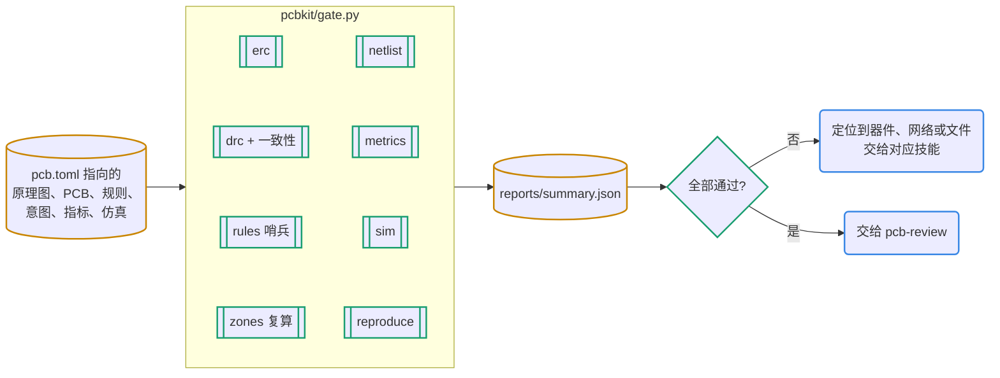

# 门禁：确定性检查说了算

门禁回答一个问题：这个提交能不能合并。它全部由确定性检查组成，不调用模型，本机和 CI 的结果一样，每次失败都能定位。人工审查只关注门禁覆盖不了的地方。

## 何时用

- “检查一下”“能合并吗”“CI 为什么红”“DRC/ERC 报错怎么办”。
- 加检查或指标、调阈值、配置 CI、对比两个版本、核对变更范围、接管已有工程。
- 修具体的版图问题交给 pcb-layout，原理图问题交给 pcb-schematic，数值问题交给 pcb-sim。

## 输入与产物

| 项 | 内容 |
| --- | --- |
| 输入 | 工程（`pcb.toml` 及其指向的文件）；对比时还要基线板子 |
| 产物 | `reports/summary.json` 和每项检查的 JSON；`checks/metrics.toml`；CI 工作流；版本对比 JSON |
| 验收 | 8 项全部 PASS 或 SKIP（不适用）；每个例外和阈值放宽在 DECISIONS 有理由 |
| 下一步 | 失败项交给对应技能修；全过后交 pcb-review |

## 流程



图例：青绿菱形是确定性检查，黄色圆柱是文件，蓝色圆角框是 agent。

## 命令

```bash
python3 pcbkit/gate.py                       # 全部检查，报告在 reports/
python3 pcbkit/gate.py --only drc,metrics    # 只跑部分检查
python3 pcbkit/metrics.py                    # 只看指标数值
python3 pcbkit/board_diff.py old.kicad_pcb hw/x.kicad_pcb [--scope docs/changes/0003.toml]
```

## 步骤

1. **跑门禁，按下表定位失败项**：

   | 检查 | 通过条件 | 失败时先看 |
   | --- | --- | --- |
   | erc | 0 错误；警告只允许在 `[gate].erc_allowed` 里且写了理由 | `reports/erc.json` 的 type 和 items |
   | drc | 违规、未连接、一致性差异都为 0；布线前可设 `allow_unrouted`；`drc_allowed` 只放写了理由的例外 | `reports/drc.json`；一致性差异先跑 `sync_pcb.py` |
   | rules | 往 `.kicad_dru` 副本追加哨兵规则，哨兵必须触发 | 规则文件有语法或约束错误，被整份丢弃 |
   | zones | 副本里用 kicad-cli 重铺，铜面积变化不超过容差 | 改了版图没重铺：`kicad-cli pcb drc --refill-zones --save-board` |
   | netlist | 连接意图；符号引脚与焊盘一一对应；引脚类型齐全；BOM 字段非空；MPN 已登记 | `reports/netlist-check.json` |
   | metrics | `checks/metrics.toml` 每条满足阈值、都有 why | `reports/metrics.json` |
   | sim | 每个基准、每个角点满足断言 | `reports/sim.json` |
   | reproduce | 副本里重跑 `[design].generate`，Git 管的文件不变 | 生成器不确定，或忘了提交生成的文件 |

   检查程序崩溃也算失败；不适用的显示 SKIP。
2. **写指标**（格式和可用的 kind 见 `references/metrics.md`）：每一条审查意见、每一个修好的缺陷，只要能写成数值，就写成指标。声明式写不出来的，写项目脚本 `checks/check_x.py`（`run(board_path) -> dict`），用 `kind = "script"` 引用。
3. **例外和阈值**：种类有 `erc_allowed`、`drc_allowed`、`extra_pads_allowed`、`[bom].exempt`、`[gate].skip`；每一条在 DECISIONS 写理由，配置里的 `why` 引用编号。阈值来自需求、数据手册或上一版实测，原则是“不退步”（S3 取 v0.2 实测值）。
4. **CI**：模板带 `.github/workflows/hw-gate.yml`（GitHub Actions）。容器 `kicad/kicad:<pcb.toml 的版本>`，root 运行并装 python3；有 `pyproject.toml` 时装 uv 做复现检查；推送 `v*` 标签时先 `uv sync --group extras`（可选输出和自拼要用），再跑 `release.py` 上传制造包。首次启用要看一遍运行日志。
5. **对比与范围**：`board_diff.py` 报告器件增删、移动和换库，焊盘铜皮，走线和过孔（按网络），锁定项，铺铜，封装图形，字段，板框。加 `--scope 变更单` 后，范围之外的改动列进 `out_of_scope`，退出码 1。

## 要点与常见坑

- 看不到理由的例外，审查时一律打回。
- DRC 查不出的问题靠指标，S3 的例子：In1 地平面走线数为 0；射频链全在 F.Cu、总长 ≤ 11 mm；非地过孔离射频铜 ≥ 0.5 mm；开关节点线宽 ≥ 0.3 mm；USB ≤ 16 mm；去耦距离不比上一版差。
- **接管已有工程**：`new_project.py <工程> --adopt …` 只加文件不改设计；先跑门禁看现状，再逐项补配置（`erc_allowed` 写理由、`[bom].required_fields`、已有检查脚本接成 `kind = "script"`、生成器写进 `[design].generate`）。照抄 `examples/s3-adoption/`：S3 的 30 条阈值写成声明式指标后，结论与它自己的门禁一致，还多查出 1 处 BOM 问题。
- S3 v0.2 → v0.2.1 的对比实例：910 个焊盘、4886 段走线、378 个过孔都没变，改动全在字段和封装图形上，与迁移说明一致。

## 参考文件

- `references/metrics.md`：声明式指标的全部 kind、判据和示例
