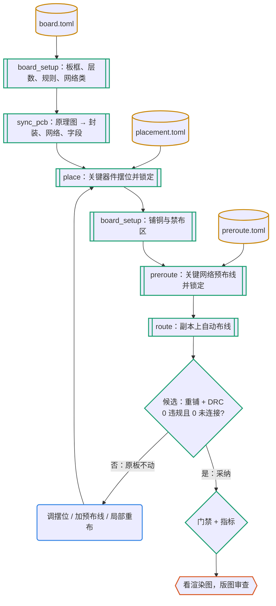

# 版图：关键的显式写，其余的自动化，结果交 DRC 判

S3 复刻和示例工程的共同教训：关键器件和关键网络要先显式定下来并锁定，再交给自动布线；布线器只遵守它看得懂的约束；自动化的结果要在副本上验证，合格才采纳。本技能把这三条落实成一条可以重跑的流程。

## 何时用

- 摆位、布线、改设计规则或网络类、加铺铜或禁布区。
- 处理 DRC 违规或未连接、拥塞区重布、评估自动布线器。
- 原理图改动先走 pcb-schematic，再用 `sync_pcb.py` 同步过来；门禁配置和指标见 pcb-gate。

## 输入与产物

| 项 | 内容 |
| --- | --- |
| 输入 | 已过门禁的原理图；SPEC 的机械和电气约束；facts.toml 的布局建议 |
| 产物 | `layout/board.toml`（板框、制造下限、网络类、铺铜、禁布区）、`placement.toml`、`preroute.toml`、`route.toml`、`hw/<板>.kicad_dru`、`hw/<板>.kicad_pcb` |
| 验收 | DRC 0 违规、0 未连接、一致性 0 差异；规则哨兵触发；铺铜最新；`checks/metrics.toml` 全过；正反面渲染图人工看过 |
| 下一步 | pcb-review（审查包）→ pcb-release |

## 流程



图例：青绿框和菱形是 pcbkit 工具与检查，黄色圆柱是版图描述文件，蓝色圆角框是 agent，橙色六边形是人。

## 命令

```bash
python3 pcbkit/board_setup.py    # layout/board.toml：板框、层数、板厚、制造下限、网络类；有了网络和器件后再建铺铜和禁布区
python3 pcbkit/sync_pcb.py       # 原理图 → PCB：增删封装、网络、字段；新器件放在板外的暂存区
python3 pcbkit/place.py          # layout/placement.toml：每条有 why，可锁定
python3 pcbkit/board_setup.py    # 铺铜和禁布区（禁布区可以按器件庭院定位）
python3 pcbkit/preroute.py       # layout/preroute.toml：关键网络，锁定
python3 pcbkit/route.py          # layout/route.toml：KiCadRoutingTools 在 work/ 副本上布线 → 重铺 → DRC → 合格才替换
python3 pcbkit/gate.py           # 全部门禁（布线完成后 pcb.toml 设 allow_unrouted = false）
kicad-cli pcb render --side top --width 1600 --height 1200 --quality basic -o work/top.png hw/<板>.kicad_pcb
<本技能目录>/scripts/setup_krt.sh  # 首次：安装 KiCadRoutingTools v0.22.1（预编译核心，不需要 Rust）
```

所有版图决定都写在 `layout/*.toml` 里时，可以从头重建（示例的 `layout/rebuild.sh`）。在 KiCad 里手改的部分以板子文件为准，重建会冲掉：要么把手改的写回文本，要么停用重建脚本并在 README 注明。

## 步骤

1. **规则**：制造下限按板厂能力表取值并留余量，DECISIONS 写来源和日期（参考 `references/fab-jlc.md`）。约束写在布线器看得懂的地方：

   | 约束 | 写在哪 | 布线器 | KiCad DRC |
   | --- | --- | --- | --- |
   | 最小线宽、间距、过孔、孔距、板边距 | `board.toml [rules]` → `.kicad_pro` | 读 | ✓ |
   | 网络类（电源加宽、射频） | `[[netclass]]`，patterns 匹配网络 | 读非 Default 类 | ✓ |
   | 某网络对其他网络的额外间距 | `.kicad_dru`，并在 `route.toml` 的 `net_clearances` 镜像 | 只认镜像 | ✓ |
   | 禁止走线、过孔、铺铜的区域 | `[[keepout]]` | ✓ | ✓ |
   | 条件规则 | `.kicad_dru` | ✗ | ✓ |

2. **摆位**：先放受机械约束的（连接器、按键、安装孔、指示灯），再放射频和开关电源功率环、紧贴电源脚的去耦电容，最后其余器件。坐标原点是板框左上角几何端点，单位 mm，y 向下。连接器要算清朝向和封装的“板边线”标记（User.Drawings 层）：示例的 USB-C 旋转 270° 后开口朝左，原点放在离板边 2.825 mm 处。丝印压焊盘时用 `ref_offset` 移位号。
3. **预布线**（格式见 `pcbkit/preroute.py`，端点可写 `"J1.B9"`，重跑先删上次的内容）：电源入口和大电流路径、开关节点和热环路、射频馈线、USB 等差分对、晶振、布线器处理不好的细间距出线（S3 的 QFN 0.4 mm 交错过孔）。
4. **自动布线**：`route.py` 一定加 `--no-fix-drc-settings`，只采纳 `.kicad_pcb`；输出在 `work/route-<时间>/`（日志、候选板、前后 DRC）。部分结果要用 `--allow-unconnected` 显式接受。失败时依次：调摆位 → 难的网络改成预布线 → KiCadRoutingTools 的局部选项（`--group`、`--nets`、`--rip-existing-nets`，经 `extra_args` 传入）→ 人工布线。
5. **验收**：门禁全过，看正反面渲染图：金属外壳下有没有走线、有没有盘中孔、丝印、极性标记、板边的连接器。

## 要点与常见坑

- `.kicad_dru` 只要有一条写错，KiCad 就静默丢弃整份文件；门禁 rules 检查用哨兵规则确认文件真的加载了。规则写法见 `references/rules.md`。
- 规则不能和封装本身冲突：示例的“VBUS 间距 0.3 mm”撞上了 USB-C 焊盘自身 0.29 mm 的间距，规则要排除焊盘对焊盘。
- 示例里自动布线器实际犯过的错：在 USB-C 金属外壳下走 0.25 mm 细线、在 B9 焊盘中心打盘中孔、无视 `.kicad_dru` 在 J1 庭院内打孔。最后改成外壳下方禁布区加 VBUS 预布线（变更单 0001）。
- 拥塞区不要逐条拆了重布（容易连锁崩溃）；S3 的编解码器区用“整窗拆除、短连接优先、不拆别人”才收敛。
- Freerouting 只作对照（需要 Java）：后几轮越跑越差、保存最后一轮而不是最好的、自动颈缩到 0.075 mm。

## 参考文件

- `references/rules.md`：三层规则、`.kicad_dru` 写法、禁布区
- `references/routing.md`：KiCadRoutingTools 参数与实测问题、Freerouting
- `references/fab-jlc.md`：嘉立创制造能力参考值（下单前回原页核对）
