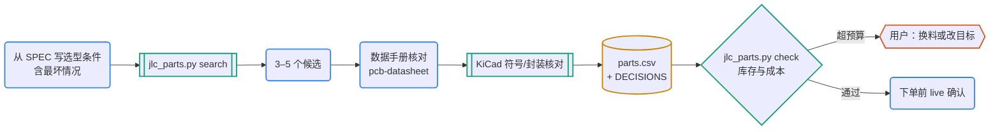

# 选料与 BOM

选料的结果是一张登记表（`parts/parts.csv`）加上每个关键选择的理由（`docs/DECISIONS.md`）。原理图里出现的每个 MPN 都必须先在登记表里有一行，门禁的 netlist 检查会核对这一点。数据来自 kicad-jlcpcb-tools 发布的嘉立创元件库（MIT），缓存在 `~/.cache/pcb-pipeline/jlcpcb-tools/`。

## 何时用

- 选型、找料、找替代料、核 BOM 成本和库存、问基础库还是扩展库。
- 不负责读数据手册：候选的参数核对转给 pcb-datasheet；电路怎么接转给 pcb-refdesign 和 pcb-schematic。

## 输入与产物

| 项 | 内容 |
| --- | --- |
| 输入 | `docs/SPEC.md` 的电气、机械、成本需求（R-xx） |
| 产物 | `parts/parts.csv` 的登记行；DECISIONS 里的选型理由；带日期的库存和价格快照 |
| 验收 | `jlc_parts.py check` 无问题；成本符合 SPEC，或已记 DECISIONS 并告知用户 |
| 下一步 | pcb-datasheet（核对候选的数据手册）→ pcb-schematic |

## 流程



图例：蓝色圆角框是 agent，青绿框和菱形是工具与检查，黄色圆柱是文件，橙色六边形是人。

## 命令

```bash
P=<本技能目录>/scripts/jlc_parts.py
python3 $P info                                    # 已下载的库、快照日期、件数
python3 $P fetch --db current                      # 约 180 MB 下载 / 770 MB 解压：排除停产件的现行库（首次用前）
python3 $P fetch --db basic                        # 0.4 MB：只有基础库和优选库，适合 CI 或快速查
python3 $P search LDO 3.3V --package SOT-23 --min-stock 1000 --limit 15
python3 $P search 5.1kΩ --package 0603 --category "Chip Resistor" --type basic
python3 $P show C14289 C5446                       # 完整记录与价格阶梯
python3 $P check bom-qty.csv --boards 10           # 每行 LCSC,Qty：库存、类型计数、物料费、扩展库费用
python3 $P live C14289                             # LCSC 实时库存、价格和 PDF 链接（下单前确认）
```

检索提示：三个字符及以上的词走全文索引；更短的词（`1k`、`5V`）按子串匹配，`1k` 也会命中 `5.1kΩ`，所以写全（`1kΩ`）。类别名用英文原文（`Chip Resistor`、`USB Connectors`、`LED Indication`、`Multilayer Ceramic`）。结果按基础库、优选库、扩展库排序，同类按库存从高到低。每次输出都带快照日期，引用价格和库存时写上日期和来源。

## 步骤

1. **写选型条件**：电压、电流、功耗、精度、封装和高度、温度、装配方式（SMT 或手焊）、单价上限。包括最坏情况：热插拔峰值、输入范围上限、电容在工作电压下的降额。
2. **检索，列 3–5 个候选**，记下 LCSC 号、类型和库存。
3. **核对数据手册**（pcb-datasheet）：分销商描述只用来缩小范围，选型依据是数据手册的数字和页码。
4. **核对 KiCad 库**：`python3 <pcb-datasheet>/scripts/datasheet.py pins <库:符号>` 看引脚；没有现成封装时优先选有封装的同类件。确需从 EasyEDA 转换封装，要逐个尺寸对照图纸，并在登记表注明来源和许可。
5. **登记**：`parts/parts.csv` 一行（MPN、Manufacturer、LCSC、Library Type、Package、Footprint、Symbol、Role、Requirements、Datasheet、Facts、Alternates、Stock、Unit Price、Snapshot、Decision）；关键选择在 DECISIONS 写理由、备选、为什么不选、关联需求。
6. **BOM 核对**：整理 `LCSC,Qty` 文件，`check --boards <套数>`。超出成本目标时换料或改目标，都记 DECISIONS 并告诉用户。
7. **下单前**用 `live` 确认。LCSC 的库存不等于嘉立创的贴片库存，以下单页面为准。

## 要点与常见坑

- 绝对最大值要大于最坏情况的瞬态，不能只比稳态；推荐工作范围覆盖稳态。
- 分销商描述常与数据手册不符（示例中实际遇到过）：
  - HT7533-1 描述写 100 mA，保证值 70 mA；
  - GCT USB4125 描述写 48 V，图纸额定 20 V；
  - 同叫 XC6206 的“兼容件”VIN 上限有 6、7、8 V 几种。
- 电容按工作电压下的有效容值选（MLCC 直流偏压降额）；电阻按功率降额。
- 嘉立创贴片同等条件下优先基础库、其次优选库；扩展库每种料有一次性上料费（约 3 美元，以当前价格为准）。
- 至少一个能直接替换的第二来源，写在 Alternates。
- 连接器、按键等机械件以图纸为准：推荐焊盘对应的板厚、插拔次数、额定电流、外壳是否接地。

## 参考文件

- `references/selection.md`：电气裕量、可制造性与供应、信息可信度、成本
