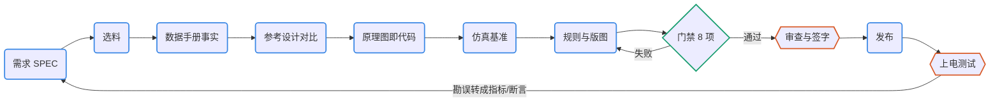

# PCB 设计流程（总控）

把一块板子的设计拆成可检查的阶段：每一步都有文本形式的产物，每次改动都要过确定性门禁，人只在关键节点签字。来源是一份 AI 与 EDA 工具调研报告的建议和 S3 AMOLED 复刻工程的实践。本技能定义阶段、工程结构和改动规则；各阶段的具体做法在对应技能里。

## 何时用

- 用户要设计一块板子、新建或接管 KiCad 工程、问“下一步做什么”。
- agent 要改原理图或 PCB：先按本技能的改动规则开分支、写变更单。
- 安装或升级工程里的 pcbkit。
- 具体阶段的工作转给对应技能（见文末“选哪个技能”）。

## 输入与产物

| 项 | 内容 |
| --- | --- |
| 输入 | 用户的目标（可以只有一句话），或已有的 KiCad 工程 |
| 产物 | 工程骨架：`pcb.toml`、`docs/`（SPEC、DECISIONS、CHANGELOG、changes/、reviews/）、`pcbkit/`、CI；每次改动的分支、变更单和 PR |
| 验收 | `python3 pcbkit/gate.py` 全过；人工签字（见阶段表） |
| 下一步 | 按阶段表转给各技能 |

## 流程



图例：蓝色圆角框是 agent 做的步骤，青绿菱形是确定性检查，橙色六边形是人工签字。

## 阶段表

| 阶段 | 技能 | 主要产物 | 自动检查 | 人工签字 |
| --- | --- | --- | --- | --- |
| 1 需求 | 本技能 | `docs/SPEC.md`（R-xx） | — | 产品负责人 |
| 2 选料 | pcb-parts | `parts/parts.csv`、DECISIONS | `jlc_parts.py check` | 硬件负责人 |
| 3 数据手册 | pcb-datasheet | `data/parts/<MPN>/facts.toml` | `datasheet.py check` | — |
| 4 参考设计 | pcb-refdesign | `refs/<名>/` | `refnet.py compare` | 原理图负责人 |
| 5 原理图 | pcb-schematic | `design/`、`hw/*.kicad_sch` | 门禁 erc、netlist、reproduce | 原理图审查 |
| 6 仿真 | pcb-sim | `sim/` | 门禁 sim | — |
| 7 规则与版图 | pcb-layout | `layout/*.toml`、`.kicad_dru`、`.kicad_pcb` | 门禁 drc、rules、zones、metrics | 版图审查 |
| 8 审查 | pcb-review | `docs/reviews/` | — | 审查结论 |
| 9 发布 | pcb-release | `release/<名>-<版本>/`、git 标签 | `release.py`（先跑门禁） | 制造审查 |
| 10 上电 | 本技能 | `docs/BRINGUP.md`、`ERRATA.md` | 勘误转成门禁项 | 测试负责人 |

选料、数据手册、参考设计、原理图常常交替进行；原理图过门禁之后才开始版图。每个阶段的进入条件、退出条件和常见遗漏见 `references/stages.md`。

## 命令

工具包在本技能目录的 `kit/`，模板在 `assets/template/`。

```bash
S=<本技能目录>          # Claude Code 会给出 "Base directory for this skill"
python3 $S/scripts/new_project.py <工程目录> --name <板名> --title "<标题>" --size 30x20 --layers 2
python3 $S/scripts/new_project.py <已有工程> --adopt --pcb x.kicad_pcb --sch x.kicad_sch --name x   # 接管：不动设计文件
python3 $S/scripts/new_project.py <工程> --update-kit    # 升级工程内 pcbkit/（单独分支、单独提交）
python3 pcbkit/gate.py                                    # 在工程目录里：门禁
python3 pcbkit/extras.py status                           # 可选输出（iBOM、KiCanvas、PcbDraw、KiKit 拼板、EMC）要哪些、装了没有
```

## 步骤

1. **新建或接管工程**。新建后先填 `docs/SPEC.md`：需求写成可验证的数值并编号，不确定的写进“未决问题”并追问用户。接管时（例如 S3）先只跑门禁看现状，按失败项逐条补配置，不为了过门禁改设计；示例在仓库的 `examples/s3-adoption/`。
2. **按阶段推进**，每个阶段读对应技能。产物都写进工程里的文本文件，数字注明出处。
3. **每次改动走事务**（详见 `references/change-control.md`）：
   - **L0 只读审查**：可以直接做，结论写进 `docs/reviews/` 或 issue。
   - **L1 分支提案**：开分支 `hw/<阶段>-<短名>` → 写变更单 `docs/changes/NNNN-<短名>.toml`（原因、范围、验收）→ 修改 → `python3 pcbkit/gate.py` → `python3 pcbkit/board_diff.py <基线板> <新板> --scope <变更单>` → PR 附这两份结果。
   - **L2 受控自动化**：摆位、预布线、布线、铺铜只用 pcbkit 脚本或布线器，在副本上运行，DRC 通过才采纳；锁定项只有变更单写明才能解锁。
4. **发布与上电**：发布交给 pcb-release；上电结果写 `docs/BRINGUP.md`，缺陷写 `ERRATA.md`，并在下一版变成指标、断言或连接意图。

## 要点与常见坑

- **禁止**：推送或合并主分支、打标签（由人做）；手改 Gerber 等制造文件；为过检删检查、关规则、放宽阈值，或加例外不记 DECISIONS；采纳布线器改写的 `.kicad_pro`；在 code 模式下手改生成的原理图。本机提交要用户同意；推送和打标签一律先问。
- **必须停下来问人**：需求冲突（数据手册保证值低于需求）、放宽阈值或加例外、改动超出变更单范围或要解锁关键项、安全合规相关、要花钱或对外发布、拼板方式（`[outputs].panel = "ask"` 时，自己拼还是交给板厂）。
- **环境**：只用系统 KiCad（先 `kicad-cli version`）；Python 依赖用 uv，非交互 shell 先 `export PATH="$HOME/.local/bin:$PATH"`；缺系统包请用户用 apt 装，不自行下载私有副本。KiCad 10 与 Debian Python 3.14 的已知问题见 `references/kicad10-notes.md`，pcbkit 已处理，自写脚本时要注意。
- **可选输出**：`pcb.toml` 的 `[outputs]` 控制 iBOM、KiCanvas、PcbDraw、KiKit 拼板和 kicad-happy EMC 预检，都不进门禁，工具没装时跳过并提示。前三个 Python 工具装在工程 uv 环境的 `extras` 组（`uv sync --group extras`），由 `pcbkit/extras.py` 先加载 kicad_compat 再调用；`kicanvas.js` 随 pcbkit 固定版本入库。不引入 KiBot（AGPL，自管依赖，与门禁和发布重叠）。
- **CI**：镜像用 `kicad/kicad:<pcb.toml 里的版本>`；模板带 `.github/workflows/hw-gate.yml`（GitHub Actions）。

## 选哪个技能

用户只说一句话时，先判断处在哪个阶段；拿不准就先跑门禁，从失败项入手。

| 用户说的 | 技能 |
| --- | --- |
| 找料、比价、换料、BOM 多少钱 | pcb-parts |
| 这颗芯片怎么接、引脚定义、绝对最大值 | pcb-datasheet，再加 pcb-refdesign |
| 和官方参考设计一样吗、晶振/复位怎么接 | pcb-refdesign |
| 加器件、改连接、换封装 | pcb-schematic |
| 会不会过压、裕量够不够、电流多大 | pcb-sim |
| 摆位、布线、DRC 报错、加铺铜 | pcb-layout |
| 能合并吗、CI 为什么红、加个检查 | pcb-gate |
| 帮我看看这块板、EMC 有没有明显风险 | pcb-review |
| 出 Gerber、下单打样、拼板 | pcb-release |

## 参考文件

- `references/stages.md`：各阶段进入、退出条件与常见遗漏
- `references/change-control.md`：事务化改动、权限分级、回滚
- `references/kicad10-notes.md`：KiCad 10、Debian 和外部工具的已知问题
