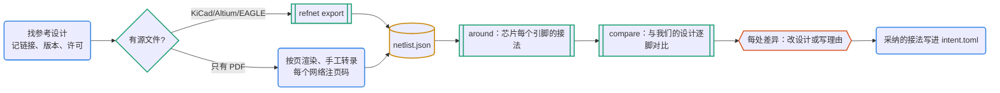

# 官方参考设计 → 逐脚对照

参考设计是数据手册之外最好的证据：去耦电容的数量、晶振串联电阻、启动配置引脚、测试引脚接地，这些细节往往只在参考设计里。脚本：`scripts/refnet.py`（标准库 + kicad-cli；从 PCB 导出时用系统 pcbnew）。

## 何时用

- 设计芯片外围电路，照着评估板、开发板或应用笔记画原理图。
- 检查“和官方参考设计一样吗”：晶振、复位、启动配置、去耦、USB 串阻怎么接。
- 单颗器件的引脚和参数转给 pcb-datasheet。

## 输入与产物

| 项 | 内容 |
| --- | --- |
| 输入 | 参考设计文件（KiCad 工程或 zip、Altium/EAGLE 等 PCB、PDF 原理图）；我们的原理图 |
| 产物 | `refs/<名>/`：来源（文件或链接加哈希、许可）、`netlist.json`、`around-<位号>.txt`、`compare.json`；DECISIONS 里每处差异的理由 |
| 验收 | 每处 `values differ` / `connections differ` 都有处理：改设计，或写 DECISIONS |
| 下一步 | 采纳的接法写进 `design/intent.toml`（pcb-schematic），由门禁守住 |

## 流程



图例：蓝色圆角框是 agent，青绿框和菱形是工具与判断，黄色圆柱是文件，橙色六边形需要人拍板。

## 命令

```bash
R=<本技能目录>/scripts/refnet.py
python3 $R export refs/rp2040-minimal/Minimal-KiCAD.zip --out refs/rp2040-minimal/netlist.json   # zip、目录、.kicad_sch/.kicad_pcb、.PcbDoc/.brd
python3 $R around refs/rp2040-minimal/netlist.json U3 --depth 2 > refs/rp2040-minimal/around-U3.txt
python3 $R export hw/<板>.kicad_sch --out work/ours.json                                        # 我们自己的网表
python3 $R compare refs/rp2040-minimal/netlist.json work/ours.json --anchor U3=U1 --json refs/rp2040-minimal/compare.json
```

## 步骤

1. **找参考设计**（常见来源见 `references/sources.md`）。优先级：厂商发布的 KiCad 文件 → Altium、EAGLE 原文件 → PDF 原理图 → 应用笔记里的电路图。记录链接、下载日期、版本、许可。
2. **导出**：`export` 支持 KiCad 原理图、板子、目录和 zip；别家格式的 PCB 用 `kicad-cli pcb import` 读入（只有 PCB 有网络），原理图格式目前不行。
3. **围绕核心芯片**：`around <位号>` 列出每个引脚的网络和网络上挂的器件、取值。电源和地按 `--stop` 的通配符归类不展开；`--depth 2` 再向外走一步（晶振、分压的另一端）。
4. **对比**：`compare --anchor 参考位号=我们的位号`。同一引脚上同类器件自动对应（同名同脚 → 同值同脚 → 同类唯一，只用信号引脚做证据），对不上的用 `--map C12=C4`。状态：`same`、`values differ`（如 15 pF 改成 22 pF）、`connections differ`（如少了串联电阻）、`supply vs signal`。
5. **处理差异**：每一处改设计或写 DECISIONS（例如“晶振换 CL = 10 pF 的型号，负载电容相应改为 15 pF，晶振规格书 p.x”）。重要的连接写进 `design/intent.toml`。

**只有 PDF 时**：用 pcb-datasheet 的 `render` 把原理图页渲染成图片（必要时放大）逐页读，按下面的格式转录核心芯片的引脚和第一层外围器件，每个网络注明页码（可另写 `notes.md`）：

```json
{"source": "<链接> p.3", "components": {"U1": {"value": "ESP32-S3", "footprint": "", "lib_id": ""}, "C5": {"value": "22pF"}},
 "nets": {"XTAL_P": [["U1", "53"], ["C5", "1"], ["Y1", "1"]]}}
```

转录完先自查：每个网络至少两个成员；芯片引脚数与数据手册一致；电源脚全部转录。矢量 PDF 也可以写脚本提取（S3 的 `gen/pdf/pdf_netlist.py` 用 PyMuPDF 做过），但要逐个工程调试，结果必须人工核对。

## 要点与常见坑

- 参考设计不等于正确设计：评估板常为测量加跳线、测试点和备用焊盘，删掉前确认没有功能依赖。
- 晶振外围、复位 RC、启动配置电阻、ESD 器件、USB 串联电阻抄错的代价最高，对比时逐一核对。
- 参考设计的版本可能比数据手册新或旧；冲突时以较新的勘误为准，记 DECISIONS。
- 参考设计有自己的许可（RP2040 最小系统是 MIT），派生前要读。

## 参考文件

- `references/sources.md`：各厂商参考设计的常见形式、格式处理（已核实的链接单独标注）
