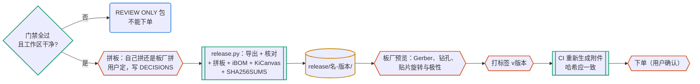

# 发布与打样

制造文件只能由脚本从过了门禁的提交生成，不能手改，也不提交进 git，作为标签的附件发布。

## 何时用

- 出 Gerber、准备下单打样、拼板、做版本发布、生成制造文件、核对贴片坐标。
- 设计还有门禁失败或未关闭的审查项时，先回 pcb-gate / pcb-review。

## 输入与产物

| 项 | 内容 |
| --- | --- |
| 输入 | main 上过了门禁、审查已签字的提交；`pcb.toml` 的 `[outputs]`，其中拼板方式由用户定 |
| 产物 | `release/<名>-<版本>/`（不入库）；git 标签 `v<revision>`（由人打）；CHANGELOG、BRINGUP 更新 |
| 验收 | `release.py` 输出 RELEASE CANDIDATE；自拼时拼板是一整块且 DRC 干净；板厂预览逐项核对；CI 附件与本地包的 SHA-256 一致 |
| 下一步 | 下单（用户确认）→ 上电测试（pcb-pipeline 第 10 阶段） |

## 流程



图例：青绿框和菱形是工具与检查，黄色圆柱是文件，蓝色圆角框是 agent，橙色六边形必须由人做。

## 命令

```bash
python3 pcbkit/extras.py status        # [outputs] 要哪些可选输出、对应工具装了没有、拼板定了没有
python3 pcbkit/extras.py panel         # 试拼：reports/extras/panel/（拼板、DRC、top.png）
python3 pcbkit/release.py              # 先跑门禁；门禁失败就拒绝生成
python3 pcbkit/release.py --step       # 另外导出 STEP（需要 3D 模型库；本机没装 kicad-packages3d 时模型是空的）
uv sync --group extras                 # 一次性：装 KiKit、InteractiveHtmlBom、PcbDraw（工程 pyproject 的 extras 组）
```

| 输出 | 内容 |
| --- | --- |
| `fab/gerbers/`、`fab/gerbers.zip` | 铜层、阻焊、钢网、丝印（减去阻焊开窗）、板框；PTH 和 NPTH 钻孔、钻孔图 PDF |
| `fab/ipc-d-356.d356` | 光板电测网表 |
| `fab/panel/` | 只在 `panel = "self"` 时有：`panel.kicad_pcb`、`drc.json`、`top.png`、拼板 Gerber、`positions.csv`、`jlc-cpl.csv` |
| `assembly/positions.csv`、`bom.csv` | 贴片坐标（不含 DNP）、分组 BOM（带 MPN、LCSC） |
| `assembly/jlc-bom.csv`、`jlc-cpl.csv` | 嘉立创格式 |
| `assembly/ibom.html` | 交互式 BOM：按位号或料号在正反面找器件，装配和返修用（`ibom = true`） |
| `review/schematic.pdf`、`pcb.pdf` | 审查用 |
| `review/kicanvas/` | 浏览器看原理图和 PCB，不用装 KiCad；要用 HTTP 打开，见其中 README.txt（`kicanvas = true`） |
| `board-stats.json`、`gate-summary.json`、`manifest.json`、`SHA256SUMS`、`README.txt` | 统计、门禁结果、来源（提交、KiCad 和 pcbkit 版本、时间、拼板方式、可选输出）、哈希 |

状态只有两种：**RELEASE CANDIDATE**（门禁通过、从干净的 git 提交生成）；**REVIEW ONLY**（没跑门禁、有未提交修改，或不是从 git 提交生成），不能拿去下单。可选输出的工具没装时跳过，README.txt 里写明原因，状态不变。

## 步骤

1. 确认 main 上的提交门禁全过，审查结论已关闭，SPEC 未决问题清零或已接受。
2. **拼板方式由用户定，agent 不替用户选**。`[outputs].panel = "ask"` 时停下来问，说明两种做法的差别：
   - `"fab"`：按单板下单，或让板厂代拼。省事，也是嘉立创小批量的常见做法；发布包里只有单板文件。
   - `"self"`：用 KiKit 按 `layout/panel.toml` 自己拼。适合要自己控制工艺边、光学点、连接桥位置，或板子太小板厂不接单的情况。拼板的 Gerber 和 CPL 进 `fab/panel/`。

   用户定了以后，改 `pcb.toml`，写进 DECISIONS（拼法、理由、代价）。选 `"self"` 时编辑 `layout/panel.toml`，跑 `extras.py panel`，**一定要看 `top.png`**（连接桥在不在、邮票孔是否避开悬伸器件），拼板 DRC 必须干净。
3. 把 `pcb.toml` 的 `revision` 和原理图、PCB 标题栏的版本改成一致（`board_setup.py` 从 pcb.toml 写入 PCB 标题栏，`board.py` 从 pcb.toml 读版本写入原理图），提交。
4. 本地运行 `release.py`，结果应为 RELEASE CANDIDATE；核对 `SHA256SUMS`。README.txt 里不应有 “PANEL NOT DECIDED” 或被跳过的可选输出（要的话先 `uv sync --group extras`）。
5. **下单前核对**（嘉立创为例）：
   - 上传 `gerbers.zip`（自拼时用 `fab/panel/gerbers.zip`），在板厂预览里检查层数、板框、钻孔（槽孔、NPTH）、阻焊开窗、丝印、板厚（与 `layout/board.toml` 一致）；
   - 上传 `jlc-bom.csv` 和 `jlc-cpl.csv`（自拼时用 `fab/panel/jlc-cpl.csv`），在贴片预览里逐个核对 pin 1 和极性（二极管、LED、电解电容、IC）、连接器朝向，以及 `reports/review/caveats.md` 里所有关于编号和极性的条目；自拼时确认每块子板都贴上了；
   - KiCad 和嘉立创的旋转角对部分封装不一致，按预览调整，调整记录写进 DECISIONS，下次直接套用；
   - `jlc_parts.py live` 确认库存和价格；扩展库件计入上料费；通孔件确认是嘉立创焊接还是手焊。
6. 由人打标签 `git tag -a v<revision> -m "..."` 并推送；CI 的 release 任务生成同样的包作附件，哈希应与本地一致（iBOM 页面带生成时间，除外），不一致要查环境差异（KiCad 版本、字体）。
7. 更新 CHANGELOG（审查意见 → 修改 → 证据）；BRINGUP 准备好上电检查和测试项。下单要用户确认，agent 不能代为下单。

## 要点与常见坑

- 示例工程的包是 REVIEW ONLY，因为仓库还没有提交，没有可追溯的版本号；示例按 D-0006 自拼 2×1。
- **拼板 DRC 干净不等于拼对了**：连接桥一个都没生成时，板子在拼板里是悬空的，DRC 照样干净。`extras.py panel` 因此另查拼板外框是不是一整块，不是就拒绝发布。
- KiKit 固定连接桥：`vcount` 是每块板**上下边**的桥数（桥沿竖直方向伸出），`hcount` 是左右边；`fixed` 类型用 `vwidth`、`hwidth`，`width` 不起作用。
- 板边有悬伸器件（USB-C 外壳、卡座）时，那一侧不放连接桥，也不朝向相邻的板。示例的 2×2 试拼里邮票孔落进了 USB-C 庭院（`npth_inside_courtyard`）。
- 拼板 CPL 里每个位号每块子板出现一次，BOM 仍用单板的 `jlc-bom.csv`，这是 KiKit 文档写明的用法（拼板 + 单板原理图）。嘉立创是否接受，以下单时的贴片预览为准。
- 费用和数量记进 CHANGELOG 或 DECISIONS：日期、报价、选项。
- 上电后的测试结果写 `docs/BRINGUP.md`，缺陷写 `docs/ERRATA.md`；每条勘误都要在下一版变成门禁项。

## 参考文件

- 版图技能的 `references/fab-jlc.md`：嘉立创制造能力参考值与贴片注意事项
- 工程里的 `layout/panel.toml`：拼板预设（KiKit 预设写成 TOML），注释里有各段的含义
- 总控技能的 `references/kicad10-notes.md`：外部工具在 KiCad 10 上的坑（kicad_compat 补丁、iBOM 的 wxPython、拼板库表）
