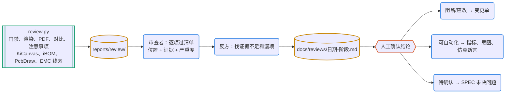

# 设计审查

两篇 HN 讨论都认为，审查是大模型在硬件设计里最划算的用法：交叉核对网表和 BOM、找原理图里的根因，有人说花一两美元的 token 省下了几十美元的坏板。审查只读不写，风险低，但结论必须有证据，而且尽量变成以后能自动执行的检查。

## 何时用

- 审查原理图或 PCB、打样前检查、PR 评审。
- 看别人的板子或开源工程、找 bug 根因。
- 修改本身不在审查范围：阻断和应改项转成变更单，按 pcb-pipeline 的事务流程改。

## 输入与产物

| 项 | 内容 |
| --- | --- |
| 输入 | 门禁通过（或至少跑过）的分支或标签；基线版本（可选） |
| 产物 | `reports/review/`（审查包，不入库）；`docs/reviews/YYYY-MM-DD-<阶段>.md`（结论表） |
| 验收 | 每条结论有位置、证据、严重度、处理方式；阻断项关闭或转成变更单 |
| 下一步 | 变更单 → 对应技能；能自动化的发现 → 指标、连接意图、仿真断言；全部关闭 → pcb-release |

## 流程



图例：青绿框是工具，黄色圆柱是文件，蓝色圆角框是 agent，橙色六边形是人。

## 命令

```bash
python3 pcbkit/review.py --base main        # 在要审查的分支上运行；没有 git 基线就省掉 --base
python3 -m http.server --directory reports/review/kicanvas 8000   # 浏览器开 http://localhost:8000/ 看原理图和 PCB
<本技能目录>/scripts/setup_kicad_happy.sh   # 一次性：EMC 预检用的 kicad-happy（固定 v2.3.1，只用脚本）
uv sync --group extras                      # 一次性：iBOM、PcbDraw、KiKit
```

审查包 `reports/review/`：

| 文件 | 内容 |
| --- | --- |
| `packet.md` | 索引：门禁、指标数值、可选输出、拼板、EMC 线索摘要、版图差异摘要、设计决定列表 |
| `top.png`、`bottom.png`、`schematic.pdf`、`pcb.pdf` | 正反面渲染、原理图、各层图 |
| `caveats.md` | 所有 facts.toml 的注意事项和布局建议，带页码 |
| `gate.json`、`diff.json` | 门禁摘要；与基线的版图差异 |
| `kicanvas/` | 浏览器里缩放、点选、查网络（KiCanvas，alpha，只用来浏览） |
| `ibom.html` | 交互式 BOM，按位号或料号在正反面高亮器件 |
| `pcbdraw-top.svg`、`pcbdraw-bottom.svg` | 风格化板图，给 README 和引脚说明用；PcbDraw 图库没有的封装只画焊盘 |
| `emc.md`、`emc.json` | kicad-happy 的规则式 EMC 预检：发现、规则号、可信度、建议 |
| `panel/` | `panel = "self"` 时的拼板、拼板 DRC、`top.png` |

可选输出的工具没装时跳过，`packet.md` 末尾写明怎么装。直接看图片和 PDF，必要时用 pcb-datasheet 的 `render` 放大某一页。

## 步骤

1. **生成审查包**。
2. **审查者一轮**：按 `docs/REVIEW-CHECKLIST.md` 和 `references/checklist.md` 逐项过。每条发现写位置（位号、网络、坐标或页码）、证据（数据手册页码、仿真或指标数值、图上位置）、严重度（阻断：会坏板或不满足需求；应改：有风险或违反规范；建议；待确认：需要外部信息或实测）。
3. **反方一轮**：逐条反驳，证据不足的降级或撤回，补上漏掉的风险。特别追问：门禁全过是不是因为检查本身漏了什么？例外和阈值放宽有没有理由？数据手册是不是同一家厂商、同一个版本？
4. **合并结论**，写进 `docs/reviews/YYYY-MM-DD-<阶段>.md`（表格，例子在 `examples/usb-ldo/docs/reviews/`），反方意见单独一段。有子 agent 时两轮各开一个，提示词模板在 `references/roles.md`；没有时自己按顺序做两轮，反方那轮要真的去找反例。
5. **EMC 线索**：`emc.md` 里每条 error 和 warning 都要核实，把它当成审查者提出的疑点，而不是结论。成立的按普通发现处理；不成立的在审查记录里写明理由（例如“J2 是调试排针，不接外部线缆”）。它的可信度字段说明依据：deterministic 来自几何或拓扑，heuristic 来自经验规则。
6. **处理发现**：阻断和应改转成变更单；每一条都问能不能变成门禁（线宽、距离、层、过孔、面积 → 指标；连接关系 → 连接意图；电压、电流 → 仿真断言；极性、装配 → BRINGUP 上电前检查和发布清单）；待确认的写进 SPEC 未决问题或 DECISIONS，并告诉用户需要谁确认。

## 要点与常见坑

- kicad-happy 的 EMC 预检按规则推断风险，不预测辐射值，也不能代替实验室测试；它是 MIT 许可，我们只调用它的分析脚本，不装它的技能（它的 11 个技能和本套重叠，同时装会抢触发）。
- 下面这些审查只能标“待确认”，不能给结论：EMC 和 SI 的定量判断、机械装配（外壳、插拔、按键行程）、热、射频性能、量产良率。需要实测、专门工具或厂商确认。
- 门禁通过的项不要重复报，除非能指出检查本身的漏洞。
- 发现如果没有转成门禁，下次还会再犯；审查的长期价值在于让门禁越来越严。

## 参考文件

- `references/checklist.md`：原理图、版图、发布前的逐项检查方法和证据
- `references/roles.md`：审查者、反方、合并三段提示词模板
- `scripts/setup_kicad_happy.sh`：在 `~/.cache/pcb-pipeline/kicad-happy-v2.3.1` 安装固定版本并校验提交号；`KICAD_HAPPY_DIR` 可指向别处
