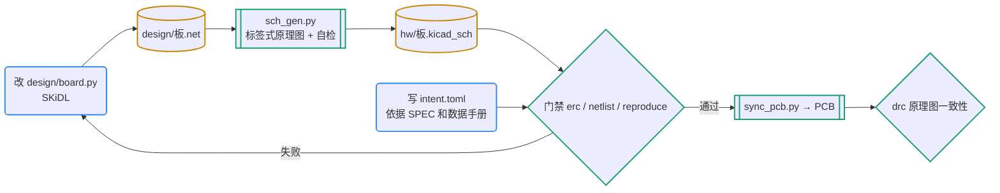

# 原理图：代码为准，门禁守住

每个工程在 `pcb.toml` 的 `[design] mode` 里二选一：

- **code**（新设计推荐，最适合 agent）：连接关系只在 `design/` 的代码里改。`hw/*.kicad_sch` 是生成物，提交进仓库供审查和 ERC，但不手改；门禁 `reproduce` 保证重新生成的结果与提交的文件逐字节一致。
- **schematic**（已有的手画工程，或人主导的设计）：`.kicad_sch` 为准。人用 KiCad 编辑；agent 只在分支上做最小修改，用连接意图和门禁兜底。

两种模式都要写 `design/intent.toml`：独立于原理图写下的功能性连接，是“原理图审查清单”的机器可执行版本。

## 何时用

- 新建或修改原理图：加删器件、改连接、换封装、把电路图变成代码。
- 原理图冻结和评审前自检。
- 选料转给 pcb-parts；外围电路怎么接先看 pcb-datasheet 和 pcb-refdesign；同步到 PCB 之后的事交给 pcb-layout。

## 输入与产物

| 项 | 内容 |
| --- | --- |
| 输入 | `parts/parts.csv`（已登记的 MPN）、`facts.toml`（引脚、典型应用）、参考设计对比结论 |
| 产物 | `design/board.py`、`design/<板>.net`（提交，便于看连接差异）、`hw/<板>.kicad_sch`、工程库表、`design/intent.toml` |
| 验收 | 门禁 `erc`、`netlist`、`reproduce` 全过（版图之前 drc 可设 `allow_unrouted`） |
| 下一步 | `python3 pcbkit/sync_pcb.py` 同步到 PCB → pcb-layout；数值问题 → pcb-sim |

## 流程（code 模式）



图例：蓝色圆角框是 agent，青绿框和菱形是工具与检查，黄色圆柱是文件。

## 命令

```bash
export PATH="$HOME/.local/bin:$PATH"
uv sync                                  # 第一次：装 SKiDL（pyproject 的 design 组）
uv run python design/board.py            # 生成网表和原理图（模板里已写好整条链）
python3 pcbkit/gate.py --only erc,netlist,reproduce
python3 pcbkit/sync_pcb.py               # 原理图 → PCB：只增删改封装、网络和字段，不动布局
```

## 步骤

1. **写电路代码**（写法见 `references/skidl.md`）：
   - 每个器件给稳定的 `tag`（如 `tag="ldo"`）：tag 决定符号 UUID，PCB 封装靠它保持链接；
   - 每个装配器件写 `p.fields['MPN']` 和 `p.fields['LCSC']`（SKiDL 2.3 的 `p.MPN = ...` 不会进网表）；
   - 符号和封装用 KiCad 自带库，并用 pcb-datasheet 的 `check` 核对过引脚；
   - `PWR_FLAG` 不写进代码，由 `sch_gen.py --power-flag <网络>` 加在连接器供电的网络上；
   - 有意不接的引脚写 `u1['VOUT'] += NC`，模板的 `mark_nc()` 把它们记进字段 `NC_PINS`（SKiDL 会把 NC 引脚从网表里删掉），sch_gen 据此放不连接标记；没声明的悬空引脚会被 ERC 报出来，这是有意为之。
2. **生成**：`board.py` 调 `generate_netlist` 再调 `sch_gen.py --normalize-input`（清掉日期和 “SKiDL Line” 行号，保证可复现）。sch_gen 的输出：器件按功能块排列（信号网络相连的成一块，只接电源的两脚无源件跟随共用电源的 IC，连接器块在前）；每个引脚一小段导线加全局标签，网络名与代码一致；位号和值放在没有引脚的一侧；纸张自动选最小尺寸；写出前用 KiCad 导出的网表逐脚核对。
3. **写连接意图**（格式见 `references/intent.md`）：每条需求、每个典型应用、每处参考设计结论，能写成连接断言的都写（`connect`、`isolate`、`net`、`[parts]`）。断言独立于代码写，依据数据手册引脚号和 SPEC，注释注明出处（如 `# R-01; HT7533-1 p.2`）。
4. **过门禁**，再 `sync_pcb.py` 同步到 PCB，用 drc 的原理图一致性确认。

| 检查 | 内容 | 常见失败与修法 |
| --- | --- | --- |
| erc | ERC 0 错误；警告只能是 `[gate].erc_allowed` 里写了理由的 | 缺 PWR_FLAG；引脚类型冲突；工程缺 `sym-lib-table` 或 `.kicad_pro` |
| netlist | 连接意图；符号引脚与封装焊盘一一对应（例外写 `extra_pads_allowed`）；引脚类型不是 unspecified；BOM 字段非空；MPN 已登记 | 封装选错；外壳脚没有符号引脚；漏填字段；没走选料流程 |
| reproduce | 副本里重跑 `[design].generate`，Git 管的文件不变 | 随机 tag、日期、行号；忘了提交生成的文件 |

## 要点与常见坑

- SKiDL 自带的 `generate_schematic()` 在 11 个器件的板子上就会失败，小电路也挤成一团，一律用 sch_gen。
- 断言不要从当前网表整份导出：那只能防改动，防不住错误。
- **schematic 模式下 agent 怎么改**：首选由人在 KiCad 里改，agent 写变更单、更新连接意图、跑门禁、审查差异。agent 直接改 `.kicad_sch` 只做最小文本修改（改字段值、换封装字段、加 DNP）；增删器件和导线请人在 GUI 里做，或先把这部分迁到 code 模式。改完必须跑 ERC 和完整门禁；`kicad-cli sch upgrade` 可把文件规范成 KiCad 自己的格式。
- 其他代码工具（tscircuit、项目自写生成器）只要能输出 KiCad 网表，都可以接 sch_gen；生成命令写进 `[design].generate`。

## 参考文件

- `references/skidl.md`：SKiDL 骨架、子电路、总线、多单元、NC、DNP、已知问题
- `references/intent.md`：intent.toml 格式、写什么、不写什么
