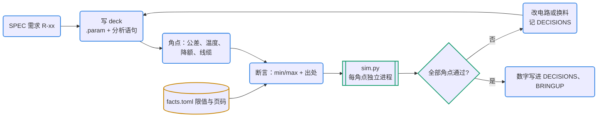

# 仿真基准：数值问题交给求解器

EEBench 的结论和 S3 的经验一致：模型容易在数值上出错，例如忘了 MLCC 降额、拿典型值当保证值。这类问题交给 SPICE 和角点分析。基准和门禁一样写进仓库，每次改动都重跑。`pcbkit/sim.py` 通过 ctypes 调用 KiCad 依赖的 `libngspice.so.0`（本机 ngspice 47），装了 ngspice 程序就用程序；每个角点在独立子进程里运行。

## 何时用

- 验证电路数值、算裕量、最坏情况和公差分析。
- “会不会超过绝对最大值”“电流够不够”“会不会振荡（有模型时）”。
- 版图寄生、EMC、SI、热不在 SPICE 基准范围内（见“要点”）。

## 输入与产物

| 项 | 内容 |
| --- | --- |
| 输入 | SPEC 里验证方式写着“仿真”的需求；facts.toml 的限值、公差和分档 |
| 产物 | `sim/<id>.cir`（能单独用 ngspice 跑的 deck）、`sim/benches.toml`（参数、角点、测量、断言）、`sim/models/`（如有） |
| 验收 | 门禁 `sim`：每个基准、每个角点满足断言；断言阈值都有出处 |
| 下一步 | 结论写进 DECISIONS 和 BRINGUP（实测时比较）；否决某个器件时回到 pcb-parts |

## 流程



图例：蓝色圆角框是 agent，青绿框和菱形是工具与检查，黄色圆柱是文件。

## 命令

```bash
python3 pcbkit/sim.py sim/benches.toml                     # 全部基准：各角点的测量值和失败项
python3 pcbkit/sim.py sim/benches.toml --only usb_hotplug --out reports/sim   # 有 export 时写波形 CSV
python3 pcbkit/gate.py --only sim                          # 门禁里的同一检查
```

## 步骤

1. **从需求出发**：每条“仿真”验证方式对应一个基准；没有需求支撑的仿真放在 `work/` 里探索，不进门禁。
2. **写 deck**（`sim/<id>.cir`）：第一行是标题，包含分析语句（`.tran`、`.ac`、`.dc`）；可变的量写成 `.param` 加 `{NAME}`。
3. **写 `sim/benches.toml`**（格式见 `pcbkit/sim.py` 的说明，示例在 `examples/usb-ldo/sim/`）：`params` 是标称值；`measures` 是去掉开头 `.meas` 的 ngspice 测量语句（如 `"tran vin_peak MAX v(vin)"`）；每个 `[[bench.corner]]` 只覆盖要改的参数并写 `why`；`[[bench.assert]]` 写 `measure` 加 `min`/`max`，`why` 写数据手册页码或需求编号。
4. **跑通并核对数量级**：标称值要能手算或凭经验核对。示例的热插拔基准，二阶欠阻尼估算约 7.3 V，仿真 7.6 V（源 5.25 V）；差得离谱先怀疑 deck。
5. **结论进文档**：数字写进 DECISIONS（示例 D-0002 用热插拔峰值否决了 XC6206），SPEC 的验证方式指向基准 id，BRINGUP 写上仿真预期值。

## 要点与常见坑

- **角点从哪里来**：
  - 器件公差（电阻 ±1 %、电容 ±10 %、稳压器精度，用 facts 的 min/max）；
  - MLCC 直流偏压降额（查厂商特性数据；查不到取 −30 %/−50 % 两档，why 里写“假设，待查证”）；
  - 温度（`.temp` 或按温度系数换算）；
  - 外部条件（线缆约 0.5–1.5 µH/m、0.1–0.3 Ω，上升时间，负载阶跃）；
  - 器件分档（LED 正向压降、MOS 管 Vth）。
- **模型**：优先用厂商 SPICE 模型，PSpice/LTspice 格式可以试 ngspice 兼容模式；加密模型不能用。没有模型时只用简化模型回答需要的问题（LDO 输入看作电阻负载，用 IS、N、RS 拟合 LED），并在 deck 注释里写明简化和拟合依据。简化模型回答不了稳定性，留给上电测试。
- **仿真不能代替**：版图寄生（地弹、回流、耦合）、EMC、SI——交给版图规则、指标和审查，需要时另用专门工具（openEMS 等，未纳入本流程）；没有模型的稳定性（陶瓷电容配 LDO，上电做负载阶跃）；热（用热阻手算，写 DECISIONS）。
- KiCad 原理图仿真（符号带 Sim 字段，`kicad-cli sch export netlist --format spice`）可以和独立 deck 并存；默认用独立 deck，问题、参数和角点更清楚。

## 参考文件

- `references/models.md`：模型来源、ngspice 兼容设置、拟合简单模型
